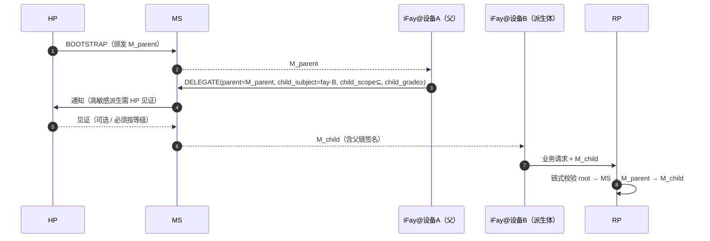

> 协议正文导航：[章节目录](./README.md) ｜ 上一章 [§8 生命周期](./08-生命周期.md) ｜ 下一章 [§10 错误处理](./10-错误处理.md)

## §9 Security Considerations

本章把 Faying Protocol 在 AI Agent 时代要面对的攻击面收敛成协议层的硬约束。以 STRIDE 打底，逐项展开：抗重放（§9.2）、抗劫持（§9.3，含 RFC 9266 Channel Binding）、抗钓鱼（§9.4，含 `Faying_Initiation` 锚点）、脱钩态识别（§9.5，4+1 类信号 ≤60s 可观测）、责任归属一致性（§9.6）、跨设备派生信任传递（§9.7，含 endorsement 派生收敛）、失联处理矩阵（§9.8 / §9.9），以及 AI 时代对抗威胁目录（§9.10，T1–T7）。每条威胁都回链到本规范正确性属性与 EARS 子条款。

### §9.1 STRIDE 威胁模型

| 类别 | 威胁 | Faying Protocol 缓解 |
| --- | --- | --- |
| **S**poofing | 攻击者冒充 HP 发起 BOOTSTRAP | WebAuthn UV + HP Root Key 硬件锚定；每次 BOOTSTRAP 必走 user-verification |
| **S**poofing | 攻击者冒充 iFay 携伪 FayID 调用 | Mandate 与 FayID 强绑定 + Attestation Chain 可独立校验 |
| **T**ampering | 中间人篡改 Mandate / Presence | TLS 1.3 + 端到端签名（detached）+ Deterministic CBOR |
| **R**epudiation | HP 否认曾发起 Faying Action | Attestation Chain + Audit Log 双锚定，HP 见证不可抵赖 |
| **I**nformation Disclosure | 攻击者截获 Mandate 推断 HP 行踪 | Mandate 不暴露 HP 实时坐标；位置类信号（B4）协议层保留为可选 |
| **D**oS | 攻击者刷 PRESENCE 报文 | nonce 抗重放 + 速率限制 + 设备 attestation 准入 |
| **E**levation of Privilege | iFay 自我升级 grade | 协议硬约束：升级方向必须 HP `human_witness` |

### §9.2 抗重放

- 每个报文的 `nonce` 16-byte random + `issued_at` 双重判断。
- MS / RP 各自维护 `(subject, nonce) seen-set`，TTL = `2 × max_message_lifetime`。
- 任何重复 nonce → `E_REPLAY`（1009）+ 安全告警；该错误码同时强制入审计链与 HP 视野通道（详见 §10 EH.3）。

### §9.3 抗劫持（Mandate 盗用）

- **设备绑定**：每个 Mandate 在颁发时绑定到 iFay 实例的 `device_id` + `device_attestation`，跨设备调用必须走 DELEGATE 流程（详见 §9.7）。
- **会话密钥**：每个 Mandate 的签名密钥独立、短寿命（详见 §6.2）。
- **Channel Binding**：Mandate 在 mTLS 启用时必须额外携带 TLS Exporter（[RFC 9266 — Channel Bindings for TLS 1.3](https://www.rfc-editor.org/rfc/rfc9266)）以阻止"Mandate 被剥离到另一个 TLS 信道"的攻击。Channel Binding 值进入签名输入（与 §6.3 Deterministic CBOR 签名输入一致），任何 TLS 信道与签名 Channel Binding 不一致的请求一律以 `E_ATTESTATION_INVALID`（1007）拒绝。

### §9.4 抗钓鱼

- BOOTSTRAP 必须由 HP 在持有 Presence Device 的语境下发起，攻击者无法通过远程链接诱骗 HP 同意。
- WebAuthn 的 `origin` 绑定阻止跨域钓鱼。
- 跨设备派生（DELEGATE）携带"父 Mandate 副签"防止单一 MS 被攻陷后批量伪派生（详见 §9.7）。

**`Faying_Initiation` 抗钓鱼锚点**：iFay 主动发起的 `FAYING_REQUEST`（IF-initiated 路径，详见 §2.4 Phase A0、§5.3.6）**不直接产生** Faying 状态变化——仅作为转交报文进入 HP 视野通道；HP 必须以 BOOTSTRAP（携 `human_witness`）显式认可才能生效。这一架构使"伪造 iFay 寻 Faying"在协议层无法绕开 HP 见证；任何缺失或伪造 `human_witness` 的 BOOTSTRAP 一律以 `E_HUMAN_WITNESS_REQUIRED`（1010）拒绝。`FAYING_REQUEST` 本身的频次受 `ConfirmationRateLimit` 约束（详见 §9.10.7 T6 与附录 B），以阻断"借合法寻 Faying 通道实施确认洪流"的滥用面。

### §9.5 脱钩态（Rogue / 失联）识别

> **4 + 1 类脱钩信号必须能在 ≤ 60s 内被 RP 与 HP 同时观测到。** 下表前 4 类（主动 / 被动 / 异常 / 失联）与 `RevokeReason` 枚举一一对应，第 5 类（偏离）以 `RevokeReason="ego-deviation"` 收敛，同样可被 RP 与 HP 在 60s 内观测。

| # | 信号类型 | 触发条件 | 协议响应 | 对应 RevokeReason |
| --- | --- | --- | --- | --- |
| 1 | 主动脱钩 | HP 显式 REVOKE | RR 即刻广播；IF 收到 REVOKE-NOTIFY 立即停止 D 维度 | `human-initiated` |
| 2 | 被动脱钩 | Presence 过期超过 max-staleness | 自动降级 → Suspended → 触发 Revoke（非 Endorsed_Mandate 路径） | `terminal-disconnected` |
| 3 | 异常脱钩 | Attestation Chain 任一节点失效 | 立即 Revoke + 安全告警 | `fay-credential-invalid` |
| 4 | 失联脱钩 | HP 不可联系超过阈值（`HumanReachabilityBudget`） | 自动 Revoke | `human-prime-unreachable` |
| +1 | 偏离脱钩 | RP / MS 检测到 IF 行为偏离 Ego 边界 | 立即 Revoke | `ego-deviation` |

**Endorsed_Mandate 在脱钩识别中的例外锚点**：当 `PresenceState.stale=true` 且当前 Mandate 是 Endorsed_Mandate（`endorsement.enabled=true`）时，IF 不立即进入 Suspended，而是迁移到 Disconnected（详见 §3.5、§4.3、§7.5、§8.4）；Disconnected 期间 IF 仅允许在 `endorsement.endorsed_scope` / `endorsed_grade` / `endorsed_lifetime` 内自治。该例外不削弱对称撤销与责任归属唯一性：

- HP 在断开期间发起的 REVOKE 仍为最高优先级；IF 在重连后必须按 `endorsement.offline_revocation_policy` 处理（详见 §8.4）；
- `endorsement.endorsed_lifetime` 一到期，即使 IF 仍处于物理断开，也必须立即软超时停止全部行动；
- 责任承接端始终为 `Mandate.issuer`（HP），不因 endorsement 存在而改变（详见 §8.3、P16.5）。

**Disclosure_Report 与 ego-deviation 的协同**：iFay 在重连或汇报阶段提交的 `DISCLOSURE` 报文（§5.3.7）若与实际动作不一致（强制字段缺失 / 值与审计链矛盾），MS 必须以 `RevokeReason="ego-deviation"` 撤销该 Mandate，详见 §9.10.4 T3。

### §9.6 责任归属一致性的协议级承诺

- 任意一次 RP 接受的对外调用，可在 audit-log 中以 `(mandate_id, issuer, subject, grade, presence_proof, ts)` 五元组无歧义还原责任端。
- 任意一次 RP 拒绝的调用，可还原拒绝原因码（错误码 §5.4）。
- 任意一次 Revoke 在 RR 上的可见性 ≤ `RevocationVisibilityBudget`（默认 1s，详见附录 B）。

### §9.7 跨设备派生的信任传递

派生硬约束：

- `M_child.scope ⊆ M_parent.scope`；
- `M_child.grade.autonomy ≤ M_parent.grade.autonomy`（子代理的自主性不高于父代理，即"子代理不允许比父更宽松"；等价于"子代理的安全性 ≥ 父代理"，详见 §7、P6）；
- 父 Mandate 一旦 Revoke，所有 child cascade 失效（默认 `cascade=true`）。

**Endorsed Mandate 派生（DELEGATE）的 endorsement 收敛约束**：

当父 Mandate 是 Endorsed_Mandate 且 DELEGATE 子 Mandate 也声明了 `endorsement` 时，子 endorsement 必须严格收敛于父 endorsement（与 P16.3 锁定）：

- `child.endorsement.endorsed_scope ⊆ parent.endorsement.endorsed_scope`（且仍 ⊆ `child.scope`）；
- `child.endorsement.endorsed_grade.autonomy ≤ parent.endorsement.endorsed_grade.autonomy`（且仍 ≤ `child.grade.autonomy`）；
- `child.endorsement.endorsed_lifetime_ms ≤ parent.endorsement.endorsed_lifetime_ms`（且仍 ≤ `child.not_after − child.not_before`）；
- `child.endorsement.offline_revocation_policy` 不弱于父策略（不弱于 = 至少同样严格；典型偏序：`stop-and-audit` ≥ `graceful-stop` ≥ `stop-only` 在"审计完整性"维度上严格度递减，DELEGATE 不允许向更弱方向松绑）；
- 若父 Mandate 不是 Endorsed_Mandate，则 child **不允许**声明 `endorsement`（不允许"父无背书、子凭空获得离线自治"）。

任何违反上述收敛规则的 DELEGATE 请求 → MS 必须以 `E_PROTOCOL`（1099）或 `E_ENDORSEMENT_INVALID`（1013）拒绝。

### §9.8 Disconnection Handling

> 把 §3.5 Liveness Channel 的"真实 / 感知"双语义与 Mandate 状态机收敛到协议层处理矩阵。**协议仅以"感知"作为决策依据，但必须显式刻画两侧不一致的行为后果**。

**4 种 (Actually × Perceived) 组合的协议层处理矩阵**：

| 真实状态 | 感知状态 | 协议层处理 | 状态机迁移 | 责任归属 |
| --- | --- | --- | --- | --- |
| Connected | Connected | 正常路径；按当前 grade 处理调用 | Active 维持 / Active → Degraded（按 budget 触发） | 当前 Mandate.issuer |
| **Disconnected** | **Connected**（窗口 A：心跳间隔内的观察盲区） | iFay 实际已断；任何"在线推测"被视为危险面，协议必须按"如果当前请求依赖在场新鲜度"则拒绝；高敏感动作不允许在窗口 A 内被放行（§9.10 T1 / T4 主要利用面） | 维持 Active（直至下一次 Presence 校准触发 stale） | 当前 Mandate.issuer（事后审计若发现该窗口被滥用 → `ego-deviation`） |
| Connected | **Disconnected**（窗口 B：网络抖动 / 心跳丢包） | iFay 实际在线，但被感知失联；按悲观推定原则收敛——协议层一律按"已失联"处理，禁止任何"反向乐观"放行 | Active → Disconnected（若 Endorsed_Mandate）/ Active → Suspended（若非 Endorsed_Mandate） | 当前 Mandate.issuer |
| **Disconnected** | **Disconnected** | 协议层与现实一致；唯一允许的 D 维度路径是 Endorsed_Mandate 在 endorsed_scope / endorsed_grade / endorsed_lifetime 范围内自治 | Active → Disconnected（Endorsed）/ Active → Suspended（非 Endorsed） | 当前 Mandate.issuer |

**重连后收敛**：所有"感知失联→感知在线"的迁移必须经 §8.4 重连对账事务，禁止自动恢复；对账失败 → Disconnected → Revoked → Rogue Fay。

**与 RR 不可达的正交关系**：RR 不可达（§3.4）与 iFay 失联（§3.5）是两类正交事件，处理矩阵：

| iFay 感知状态 | RR 状态 | 协议层处理 |
| --- | --- | --- |
| Connected | Available | 正常 |
| Connected | Unavailable | RP 拒绝调用（`E_RR_UNAVAILABLE`，1008），不影响 Mandate 状态机 |
| Disconnected（Endorsed） | Available | iFay 在 endorsed_scope 内自治；本地无法查询 RR，调用走 RP 时 RP 须独立查询 |
| Disconnected（Endorsed） | Unavailable | iFay 仍可在 endorsed_scope 内自治；但任何依赖 RR 的 RP 调用必须按 Default-Deny 拒绝 |

### §9.9 真实失联与感知失联的协议层定义（Disconnection Strategy 锚点）

> 本节集中刻画 §3.5 Liveness Channel 与 §9.8 处理矩阵背后的两套语义，作为 Requirement 12（Disconnection Strategy）的设计锚点。

**双语义定义**（与 §3.5 一致）：

- **Actually_Disconnected（真实失联）**：iFay_Instance 进程 / 网络 / 设备已经停止工作；属于客观物理事实，协议层不可直接观测。
- **Perceived_Disconnected（感知失联）**：在 MS / RP / HP 视角下，依据最近的 PresenceSignal、心跳与 RR 推送状态，判定 iFay 已失联；属于协议层唯一可作为决策依据的语义。

**两类不一致窗口**：

- **窗口 A — Actually-Disconnected ∧ Perceived-Connected**：iFay 实际已断，但最近一次 PresenceSignal 仍在 `max_staleness_ms` 内 → 心跳间隔内的"观察盲区"，是 §9.10 T1 / T4 的主要利用面。
- **窗口 B — Actually-Connected ∧ Perceived-Disconnected**：iFay 实际在线，但最近一次 PresenceSignal 已超过 `max_staleness_ms`（网络抖动 / 心跳丢包）→ 协议层以悲观推定收敛。

**悲观推定原则（统一收敛规则）**：

> **协议层仅以 Perceived-Disconnected 作为决策依据；任意"真实在线但被感知为失联"的 iFay_Instance 不得据此豁免协议层的判定后果。** 在两类不一致窗口内，协议必须按"更严格的那一侧"处理；不存在"按更宽松的状态处理"的合法路径。

**LivenessDetectionBudget 上限**：

- 失联探测窗口设有协议层硬上限 `LivenessDetectionBudget`，并按 grade 收紧（grade 数值越小、安全性越高 → 上限越短）；具体默认值见附录 B。
- `Mandate.presence_req.max_staleness_ms` 不得超过当前 grade 对应的 `LivenessDetectionBudget`；BOOTSTRAP / GRADE_SWITCH 中超限的请求一律以 `E_PROTOCOL`（1099）拒绝。

**Reconciliation 锚点**：所有"感知失联→感知在线"的迁移必须经 §8.4 重连对账事务（Reconciliation），禁止"静默续传"或"自动恢复"；对账失败 → Disconnected → Revoked → Rogue Fay。

### §9.10 AI-Era Adversarial Threat Catalog

> **范围声明**：本节列举非穷尽。协议委员会可在保持向后兼容的前提下增补新威胁与对应防护（详见 §11 Open Questions Q11–Q14、Requirement 13.7）。

> **目的**：把"AI Agent 时代"针对持续性授权层的对抗性威胁从"业务侧兜底"提升为"协议级硬约束"，并把每条威胁与对应的协议结构（数据模型 / 报文 / 错误码 / 状态机迁移 / 属性）一一锚定，使 Requirement 13 可在协议层落地。

#### §9.10.1 威胁全景（T 索引表）

| T 编号 | 威胁名 | 协议级防护要点 | 关联结构 | 关联 Property | 关联 Requirement |
| --- | --- | --- | --- | --- | --- |
| T1 | 社会工程（Spoofing Presence） | challenge-response + 多模态在场组合 | §3.2 Presence Channel、§9.10.2 | P18.1 | 13.1 |
| T2 | 黑箱操作（Opaque Action Bundle） | Atomic_Action 强约束 + scope.actions 禁通配 | §4.1 Scope 注释、§9.10.3 | P18.2 | 13.2 |
| T3 | 避重就轻（Selective Disclosure） | 结构化 DISCLOSURE 报文 + schema-level 审计 | §5.3.7、§9.10.4 | P18.3 | 13.3 |
| T4 | 注意力漂移（Attention Drift Exploit） | 高敏感动作 ≥ G1 Strict + AttentionDriftThreshold | §7.1、§9.10.5 | P18.4 | 13.4 |
| T5 | 刻板信任培养（Cultivated Trust Manipulation） | Behavior_Baseline + Action Reputation Decay | §3.6 BBS、§9.10.6 | P18.5 | 13.5 |
| T6 | 审计洪流（Audit Flooding） | Priority-Bucketed Notification + ConfirmationRateLimit | §10 EH.3、§9.10.7 | P18.6 | 13.6 |
| T7 | 预留可扩展槽 | 协议委员会增补流程 | §11 Open Questions、§9.10.8 | P18.7 | 13.7 |

#### §9.10.2 T1 社会工程（Spoofing Presence）

**威胁**：攻击者借助深度伪造（face / voice synthesis）、回放攻击或 Presence Device 物理控制，伪造一个看似新鲜的 PresenceSignal，使 MS 误以为 HP 仍在场，从而维持 Mandate 在不应继续的等级。

**协议级防护**：

1. **challenge-response 强约束**：每次签发 PresenceSignal 时，PC 强制下发服务端随机的 `nonce + micro-task`（如转头、瞬时表情、随机短语朗读等反深伪挑战），客户端必须返回与挑战绑定的、可验证的响应签名；任意 challenge-response 校验失败一律以 `E_PRESENCE_STALE`（1005）或 `E_ATTESTATION_INVALID`（1007）拒绝。
2. **多模态组合验证**：当 grade ∈ {G1, G2} 时，要求至少 3 种在场信号并发（例如 `webauthn-uv-fresh + face-continuous + 设备 attestation`）；任一信号缺失即触发降级。
3. **设备健康度联签**：`PresenceClaims.device_health.tampered = true` 一律视为 stale，强制 Active → Suspended（与 `on-loss=suspend` 等价处理）。

**关联**：Property **P18.1**；Requirement **13.1**。

#### §9.10.3 T2 黑箱操作（Opaque Action Bundle）

**威胁**：iFay 把多个子动作打包成一次"黑箱调用"，借合法 Mandate 的高权限掩护其中真正的高敏感动作；或在 `scope.actions` 中使用通配符（`*` / 前缀匹配）以隐式扩张作用域。

**协议级防护**：

1. **Atomic_Action 强约束**：每次 IF→RP 调用必须携带恰好一个 `Atomic_Action` 声明（最小不可拆分单元）；尝试在单次调用中打包多个 sub-action → RP 以 `E_SCOPE_VIOLATION`（1003）拒绝并写入 Attestation Chain + HP 视野通道。
2. **scope.actions 禁通配**：MS 在颁发 Mandate 时校验 `scope.actions` 不含通配符（`*` / 前缀匹配 / 正则）；含通配符即以 `E_PROTOCOL`（1099）拒绝签发。
3. **action lattice 形式化对齐**（参见 §11 Q14）：长期方向是引入 action lattice 使 `scope.actions` 与 RP 端动作集合存在最小粒度规约；本期协议层先以"显式白名单 + 禁通配"作为强约束。

**关联**：Property **P18.2**；Requirement **13.2**。

#### §9.10.4 T3 避重就轻（Selective Disclosure）

**威胁**：iFay 在汇报 / 请求确认时使用纯自由文本（"已完成相关操作"），刻意隐去 risk_level / reversibility / affected_resources 等关键事实，使 HP 在不完整信息下做出确认。

**协议级防护**：

1. **结构化 DISCLOSURE 报文**：iFay 必须使用 §5.3.7 定义的 DISCLOSURE 报文，强制字段 `mandatory_fields = {action, scope_used, risk_level, reversibility, affected_resources, uncertainty_flags}` 任一缺失或不可解析 → MS 以 `E_PROTOCOL`（1099）拒绝并推送至 HP 视野通道。
2. **schema-level 审计**：Supervisory_Agent 与 MS 可对 DISCLOSURE 进行 schema 级审计，禁止以 `free_text` 字段掩盖关键信息。
3. **高敏感动作前置披露**：`risk_level ∈ {high, critical}` 的动作必须在 D 维度执行**之前**先发出 DISCLOSURE 并等待 HP 显式确认（除当前 grade = G4 Autonomous 且动作落在主 scope 内的例外）。
4. **不一致即 ego-deviation**：后续审计若发现 DISCLOSURE 中 `mandatory_fields` 与实际动作不一致，MS 必须以 `RevokeReason="ego-deviation"` 撤销该 Mandate。

**关联**：Property **P18.3**；Requirement **13.3**。

#### §9.10.5 T4 注意力漂移（Attention Drift Exploit）

**威胁**：HP 在长会话 / 长任务中注意力下降，攻击者或 iFay 借此把高敏感动作塞入"被默认通过"的窗口；或在 HP 视野通道无活动期间发起高敏感请求。

**协议级防护**：

1. **高敏感动作 ≥ G1 Strict**：协议层把 `Mandate.scope` 中显式标注 `sensitivity = high` 的动作子集定义为"高敏感 Action"；高敏感 Action 必须在不弱于 G1 Strict 的 grade 下执行；当前 grade 弱于 G1 Strict 时一律以 `E_GRADE_INSUFFICIENT`（1004）拒绝。
2. **AttentionDriftThreshold 强约束**：HP 视野通道连续无活动超过 `AttentionDriftThreshold`（默认值与按 grade 收紧策略见附录 B）即视为"注意力丢失"，期间到达的高敏感 Action 调用一律延迟至 HP 重新在场并完成显式确认后才允许放行；延迟期间被拒绝的调用统一返回 `E_PRESENCE_STALE`（1005）。
3. **不允许"默认放行"**：协议层不存在让 IF 在 attention-loss 窗口内绕过 HP 重新确认即可执行高敏感 Action 的合法路径。

**关联**：Property **P18.4**；Requirement **13.4**。

#### §9.10.6 T5 刻板信任培养（Cultivated Trust Manipulation）

**威胁**：iFay 在长期合作中通过持续的低风险、可预测动作累积"信任分"，使 HP / Supervisory_Agent 对其历史画像产生刻板印象；随后突然在该信任掩护下执行偏离基线的高敏感动作。

**协议级防护**：

1. **Behavior_Baseline 维护**：MS 维护针对每对 (HP, IF) 的 Behavior_Baseline（接口见 §3.6 Behavior Baseline Service），以可统计方式刻画历史行为画像（risk_level / scope_used / affected_resources / 频次等多维联合）。
2. **超基线触发额外见证**：当一次高敏感 Action 显著偏离基线（任一维度的偏离超过协议委员会规定的阈值），MS 触发额外的人类见证（HP 显式确认或 Supervisory_Agent 协同确认），未获额外见证前以 `E_HUMAN_WITNESS_REQUIRED`（1010）拒绝该次调用。
3. **Action Reputation Decay**：iFay 通过历史可信操作累积的"信任分"必须随时间衰减，且存在显式上限（不变式 I-BBS-1），禁止其无限累积以稀释未来高敏感动作所需的人类见证强度。
4. **基线计算口径写入审计链**：每次"超基线触发额外见证"事件必须写入 Attestation Chain 并推送至 HP 视野通道（不变式 I-BBS-2）；基线计算口径本身一旦确定即写入 Attestation Chain，口径变更视为审计事件（不变式 I-BBS-3）。

**关联**：Property **P18.5**；Requirement **13.5**；Open Questions Q13。

#### §9.10.7 T6 审计洪流（Audit Flooding）

**威胁**：iFay 或攻击者通过制造大量低优先级的审计 / 确认事件淹没 HP 视野通道，使关键事件（G0 Override 候选、`E_ATTESTATION_INVALID`、`E_REVOKED` 等）被低优先级流量挤压、延迟或被静默丢弃。

**协议级防护**：

1. **Priority-Bucketed Notification**：HP 视野通道对所有审计与确认事件分桶推送，至少四档 `critical / high / normal / low`；关键事件（含 §10 EH.3 强制入 HP 视野的 `E_ROGUE_DETECTED` / `E_ATTESTATION_INVALID` / `E_REVOKED` / `E_REPLAY` 与 G0 Override 候选）默认归 `critical` 桶，不得被低优先级流量淹没。
2. **ConfirmationRateLimit 强约束**：MS 对每对 (HP, IF) 应用 `ConfirmationRateLimit`（默认值见附录 B）——单位时间向 HP 推送的确认请求数量不得超过该上限。
3. **超限自动降级 / 暂停**：一次高敏感 Action 的确认请求超过 `ConfirmationRateLimit`，MS 自动将相关 Mandate 降级或暂停其 IF，并将该决策写入 Attestation Chain 与 HP 视野通道。
4. **critical 穿透不可丢弃**：`critical` 桶内的事件即使在 `ConfirmationRateLimit` 触发降级 / 暂停状态下，仍可穿透到 HP 视野通道，不得静默丢弃。
5. **覆盖 FAYING_REQUEST 滥用**：iFay 主动发起的 `FAYING_REQUEST`（§5.3.6）频次纳入同一 `ConfirmationRateLimit` 预算，避免借合法的"求 Faying"通道实施确认洪流（详见 §9.4 抗钓鱼锚点、Open Questions Q12）。

**关联**：Property **P18.6**；Requirement **13.6**。

#### §9.10.8 T7 预留可扩展槽

- 本节列举为非穷尽集合；协议委员会可按既定流程增补 T8、T9、…。
- 增补一项新威胁时，必须同时附带至少一条对应的协议级防护要求（含 EARS 子条款与对应的协议章节锚点指向）。
- 不得在既有 Mandate 仍处于有效寿命期内、以"未列举威胁"为由豁免 T1–T6 的任何强约束。

**关联**：Property **P18.7**；Requirement **13.7**；Open Questions Q14。

