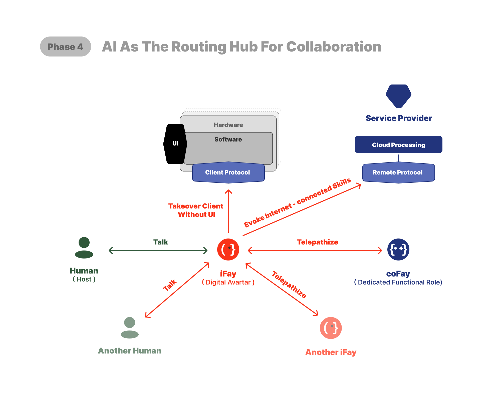
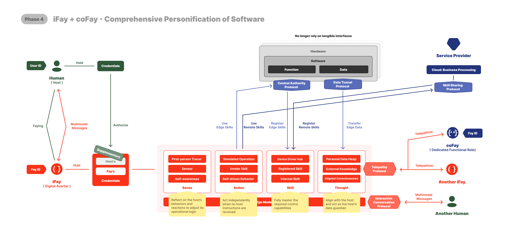

# Phase 4：引入 coFay

Phase 4 把視角從「一個人類原型 + 一個 iFay」擴展到組織維度，引入 iFay ↔ coFay 的協作。

coFay 的歸屬端通常不是某一具體自然人，而是一個組織、一個團隊，或一個角色。這一身份特性使 Phase 4 的核心難點不在於「如何監護 coFay」，在於：

> **如何讓 coFay 的監護職責落到具體的人或角色上，避免它在事實上滑入「無人監護」的灰色地帶。**

第十一章已經從價值觀層面給出過原則：任一 Fay 都不能以「我屬於一個組織」為由游離於 Human View 之外。Phase 4 要把這條原則落到協定形態。

## 兩類新關係

Phase 4 引入兩類新關係。

**iFay ↔ coFay 的委託**——某個 iFay 把一項任務委託給一個 coFay 執行。例如個人 iFay 委託公司層面的差旅 coFay 代訂機票。

**iFay 與 coFay 在共同任務中的協作**——多個 iFay 與一個 coFay 共同推進一項跨部門專案。

無論哪種關係，Phase 4 的設計基線必須保證兩件事：coFay 自身處於 Faying State，歸責落到組織內部某一具體責任端（人或角色）；iFay 與 coFay 之間的委託或協作行為，歸責上不允許出現「責任端跳變」——iFay 委託產生的後果，仍然有具體可追溯的人或角色承接。

## 三個核心議題

**coFay 的歸屬端必須顯式聲明**。組織必須在制度與協定兩個層面同時表達「誰有權代表組織行使對該 coFay 的監護」。藍圖禁止「組織作為整體抽象擔責」的模糊歸屬——這一禁止直接對應第一章描繪的「Fay 之間自主交易、雙方法務找不到具體締約人」的現實痛點。

**委託的可見性**。iFay 把任務委託給 coFay 的動作，必須對委託發起方的人類原型與 coFay 的監護方都可見。Phase 4 不允許「暗中委託」。

**責任在協作中不丟失**。當 iFay 與 coFay 共同完成一項任務時，每一項具體行為必須能被追溯到 iFay 或 coFay 之一作為執行主體，並由對應的責任端承擔。不存在「兩邊都在做、但沒人具體負責」的協作樣態。

## 與本期範圍的關係

**Phase 4 不在本期協定設計範圍內**。本期 Faying Protocol 僅覆蓋 Phase 1，不引入 coFay 的監護協定形態。本章對 Phase 4 的描繪是為了完成使命路徑的整體敘事，讓讀者理解從「個人監護」過渡到「組織監護」的演進邏輯。

Phase 4 是 Faying Protocol 第一次直面「組織」這一種社會形態。組織的複雜性會讓監護責任的邊界比此前更模糊；Phase 4 的存在，是為了讓 Faying Protocol 在這種模糊性中仍然保持歸責的一致性。這是 Phase 5 能夠展開的前置條件。

