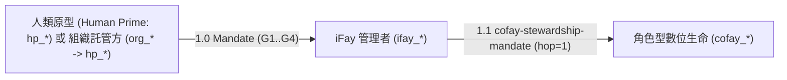

## §1 概述與定位

本規範定義 **Faying Protocol/1.1（coFay Delegated Stewardship Profile，coFay 委派託管擴充設定）**。本規範嚴格遵循 `Faying Protocol/1.0` 第 §1.7.2 節之 `MINOR` 向後相容增補規則：`Faying Protocol/1.0`（`2025-10-25` 定稿與 `schemas/fap-1.0.cddl`）的所有報文、狀態機與錯誤碼保持完全不變；僅支援 `1.0` 的對端在協商階段按 §1.7.3 回退至 `Faying Protocol/1.0`，或安全忽略不識別的可選擴充。

在 iFay 體系（`Fay = iFay + coFay`）中，`iFay` 擁有唯一固定的人類原型（Human Prime），而 `coFay` 是圍繞專業角色章程（Role Charter）持續運行的矽基數位生命，不綁定單一自然人人格包。為堅守體系第一性倫理底線——**任意矽基實體的每一次對外行動都必須唯一歸責到具體人類原型（Human Prime）**——本規範在 `Human Prime ↔ iFay` 授權鏈末端增補受密碼學約束的 `iFay Manager → coFay` 委派託管與雙簽移交契約。

### §1.1 規範性關鍵詞聲明（RFC 2119 & RFC 8174）

本文件中的英文大寫關鍵詞 `MUST`、`MUST NOT`、`REQUIRED`、`SHALL`、`SHALL NOT`、`SHOULD`、`SHOULD NOT`、`RECOMMENDED`、`NOT RECOMMENDED`、`MAY` 與 `OPTIONAL` 按照 [BCP 14](https://www.rfc-editor.org/info/bcp14)（[RFC 2119](https://www.rfc-editor.org/rfc/rfc2119) 與 [RFC 8174](https://www.rfc-editor.org/rfc/rfc8174)）解釋，當且僅當以全大寫形式出現或對應下表中的中文規範性動詞時具備規範性約束力：

| 繁體中文規範性表述 | RFC 2119 / RFC 8174 對應語義 |
| --- | --- |
| **必須** / **須** | `MUST` / `REQUIRED` / `SHALL` |
| **不得** / **嚴禁** | `MUST NOT` / `SHALL NOT` |
| **應當** / **建議** | `SHOULD` / `RECOMMENDED` |
| **不建議** | `SHOULD NOT` / `NOT RECOMMENDED` |
| **可以** / **可選** | `MAY` / `OPTIONAL` |

多語種版本出現歧義時，以簡體中文（`zh-CN`）正文與 `schemas/fap-1.1-cofay.cddl` 為權威基準。

---

## §2 三層責任穿透架構

`coFay` **不得**自行簽發根授權，也**不得**綁定脫離人類原型問責的匿名主體。每一份合法的 `cofay-stewardship-mandate` **必須**構成如下三層可驗證責任穿透鏈：

1. **終極問責層（`steward_entity` + `accountable_human_prime`）**：
   - 個人託管時，`steward_entity` 為 `hp_*`，且**必須**與 `accountable_human_prime` 完全一致；
   - 組織託管時，`steward_entity` 為 `org_*`，且**必須**顯式指定承擔終極法律與倫理問責的 `accountable_human_prime`（`hp_*`）。缺失或格式非法的報文**必須**以錯誤碼 `1010 E_HUMAN_WITNESS_REQUIRED` 拒絕。
2. **管理代理層（`manager_fay_id`）**：
   - **必須**是持有有效 `Faying Protocol/1.0` Mandate 的 `ifay_*` 實體；任何 `cofay_*` 實體**不得**充當上游簽發者。
3. **執行主體層（`subject_cofay_id`）**：
   - **必須**是符合角色章程（`charter_id`）約束的 `cofay_*` 實體，其一致性測試由 `coFACTS` 承擔（與面向 `iFay` 的 `iFACTS` 嚴格分軌）。

---

## §3 四項非放大安全不變式（Normative）

校驗器在評估 `cofay-stewardship-mandate` 時**必須**按順序強制執行以下四條不變式：

1. **上游 `G0` 與吊銷級聯停機（Cascading Safe-State Halt）**：
   - 當上游人類原型或 `iFay` 管理者的運行態處於 `G0`（`EmergencyOverride`）或 `Revoked` 時，`coFay` **必須**立即轉入 `safe-state-halt` 安全停機態，並返回 `1024 E_UPSTREAM_EMERGENCY_HALT`，**不得**憑本地快取繼續對外呼叫終端（Host）或外部技能。
2. **單跳託管上限（Single-Hop Ceiling）**：
   - `hop_count` **必須**恆等於 `1`，`max_stewardship_hops` **必須**恆等於 `1`。若 `hop_count != 1` 或簽發者不是 `ifay_*`，校驗器**必須**返回 `1023 E_STEWARDSHIP_HOP_LIMIT`。`coFay` **嚴禁**向下游再次轉授託管權。
3. **授權等級單調不放大（Grade Non-Amplification）**：
   - 託管 `grade`（`0..4`）**必須**滿足 `grade <= manager_grade`。任何試圖賦予 `coFay` 高於其 `iFay` 管理者自主等級的報文**必須**以 `1021 E_GRADE_AMPLIFICATION` 拒絕。
4. **範圍與時間窗雙重收斂（Dual Scope Convergence）**：
   - 託管 `scope` 的 `domains`、`actions`、可選 `terminals` 與預算上限（`max_invocations`、`max_cost_units`）**必須**同時是 `charter_scope`（角色章程邊界）與 `manager_scope`（管理者授權邊界）的子集；
   - 有效期 `[not_before, not_after]` **必須**完整落在 `[manager_not_before, manager_not_after]` 之內且覆蓋當前評估時刻。違反任一條件**必須**返回 `1022 E_SCOPE_ESCAPE`。

---

## §4 原子化雙簽託管權移交（`cofay-transfer`）

由於 `coFay` 不綁定單一自然人終身身份，當崗位輪換或組織重組引發託管主體變更時，移交過程**必須**透過 `cofay-transfer-authorization` 原子完成，以杜絕單方強奪或責任真空：

- **雙簽域分離規範化輸入**：移出方（`from_steward`）與接收方（`to_steward`）**必須**對去除簽名欄位後的載荷執行 RFC 8785 JCS 規範化序列化，並在位元組前綴拼接 `"ifay.faying.cofay-transfer.v1:"` 後分別產生有效密碼學簽名（`Ed25519`、`ES256` 或 `ML-DSA-65` 協商位）。
- **原子生效判據**：
  1. `from_steward` 與 `to_steward` **不得**為同一主體（禁止無意義自移交）；
  2. 雙方均**必須**綁定合法的 `from_human_prime` 與 `to_human_prime`（`hp_*`），並指明接收後的新任 `next_manager_fay_id`（`ifay_*`）；
  3. 評估時刻**必須**處於 `[issued_at, expires_at]` 視窗內，且 `nonce` 長度不少於 8 字元；違反視窗或主體約束返回 `1026 E_TRANSFER_WINDOW_OR_PARTY_INVALID`；
  4. 任一方簽名缺失或驗簽失敗時，移交整體回滾並返回 `1025 E_TRANSFER_DUAL_SIG_REQUIRED`。移交成功後，`coFay` 在公譽鏈（GMChain）上的歷史履職紀錄依公譽鏈繼承規則保持連續可追溯，且美譽值（MeriToken，`μ`）嚴格維持非貨幣化聲譽計量屬性。

---

## §5 權威 Schema、錯誤碼表與一致性向量

### §5.1 新增錯誤碼（1021–1026）

| 錯誤碼 | 錯誤名稱 | 觸發條件 | 運行時動作 |
| --- | --- | --- | --- |
| `1010` | `E_HUMAN_WITNESS_REQUIRED` | 複用 1.0：缺少合法 `accountable_human_prime` 問責錨點 | 拒絕託管 |
| `1021` | `E_GRADE_AMPLIFICATION` | `grade > manager_grade` 或等級越界 | 拒絕託管 |
| `1022` | `E_SCOPE_ESCAPE` | `scope` 或時間窗越出 `charter_scope ∩ manager_scope` | 拒絕託管 |
| `1023` | `E_STEWARDSHIP_HOP_LIMIT` | `hop_count != 1` 或非 `ifay_*` 簽發者轉授 | 拒絕託管 |
| `1024` | `E_UPSTREAM_EMERGENCY_HALT` | 上游處於 `G0` 或 `Revoked` | 立即進入 `safe-state-halt` |
| `1025` | `E_TRANSFER_DUAL_SIG_REQUIRED` | 託管移交缺少移出方或接收方有效簽名 | 回滾移交 |
| `1026` | `E_TRANSFER_WINDOW_OR_PARTY_INVALID` | 自移交、移交視窗過期或主體標識非法 | 拒絕移交 |

### §5.2 互操作三件套錨點

- **CDDL 權威定義**：`schemas/fap-1.1-cofay.cddl`
- **JSON Schema 視圖**：`schemas/fap-1.1-cofay.json`
- **跨語言測試向量**：`vectors/cofay-stewardship-v1.1.json`（含 `V01`–`V10` 共 10 組確定性向量，已由 TypeScript 與 Rust 參考實作雙向驗證通過）。
