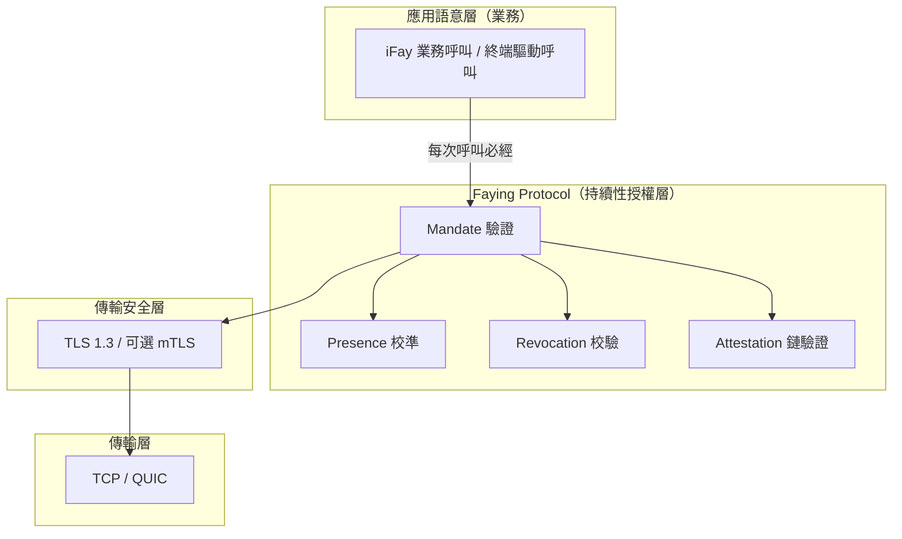
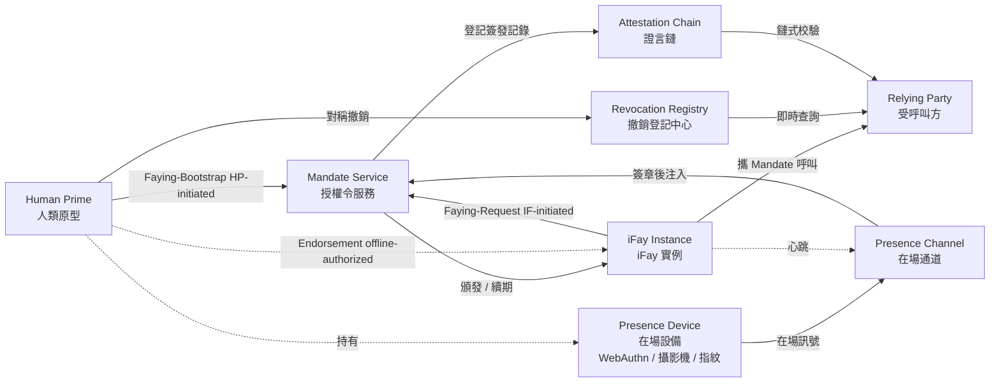
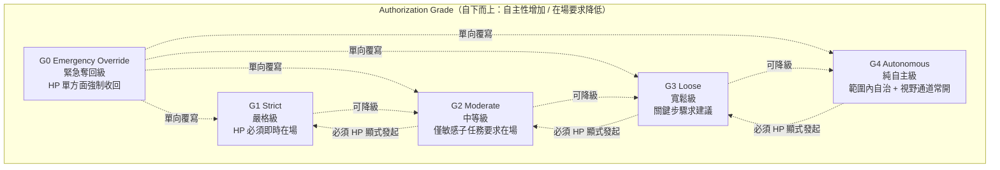
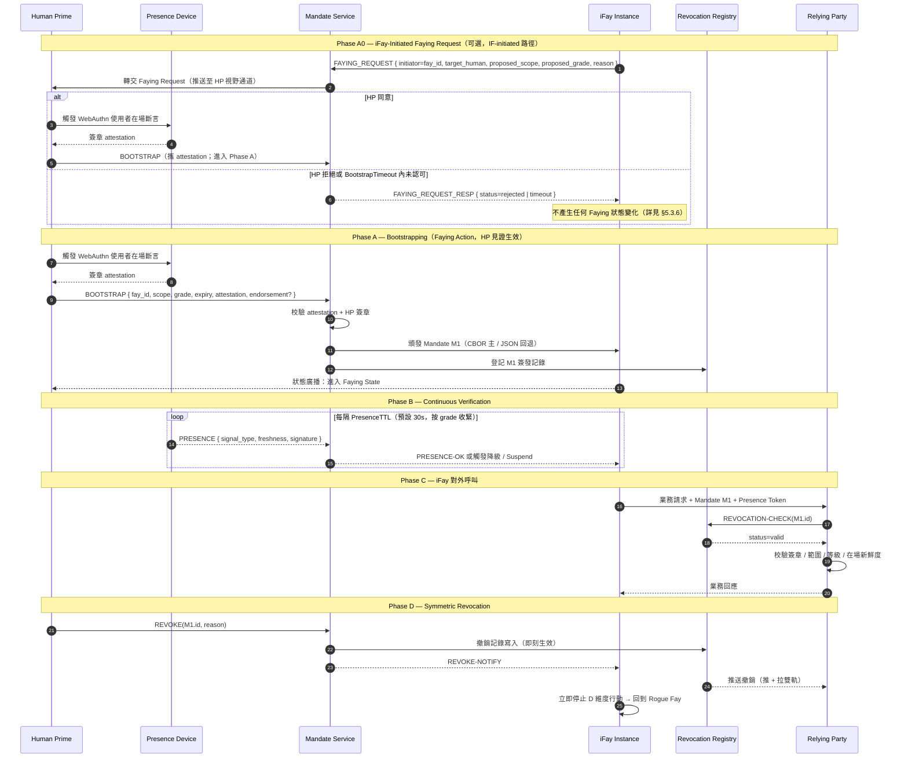

> 協定正文導航：[章節目錄](./README.md) ｜ 上一章 [§1 概述](./01-概述.md) ｜ 下一章 [§3 元件與介面](./03-元件與介面.md)

## §2 Architecture

本章從架構視角說明 Faying Protocol 長什麼樣：

- **§2.1 協定棧定位**：刻畫 Faying Protocol 在 TLS 1.3 之上、業務語意之下的層次位置，明確「每一次 iFay 對外行為必經 Mandate 校驗閘門」這一硬約束；
- **§2.2 實體關係**：列出協定涉及的 7 類實體及其職責邊界，並給出雙向 Faying 邊（HP-initiated / IF-initiated）與離線背書邊（Endorsed Mandate）；
- **§2.3 授權等級層次**：以 G0–G4 五檔等級在自主性 / 在場要求兩個維度上的相對位置呈現等級譜與切換方向；
- **§2.4 核心互動時序**：把 BOOTSTRAP（含 Phase A0 IF-initiated 路徑）+ Continuous Verification + Action + Symmetric Revocation 串為一條端到端時序，作為後續章節（§5 封包 / §7 等級 / §8 生命週期 / §10 錯誤處理）的視覺錨點；
- **§2.5 設計原則**：陳述協定層必須始終遵循的 6 項設計原則（Default-Deny / Least-Privilege / Continuous-Verification / Auditable-by-Construction / Human-Override / Graceful-Degradation）。

> **EARS 追溯說明**：本章每條架構級硬約束後以 `Trace:` 列出其對應的 EARS 子條款編號（出處見本規範需求基線），形式為 `R<requirement>.<criterion>.<clause>`。
>
> **術語對齊**：本章出現的實體名（Human Prime / iFay Instance / Presence Device / Mandate Service / Presence Channel / Attestation Chain / Revocation Registry / Relying Party 等）與附錄 A 術語對齊速查表完全一致；當本章與附錄 A 在術語上出現任何歧義時，以**附錄 A 為準**。

### §2.1 協定棧定位

**設計立場**：Faying Protocol 不取代 TLS，亦不重新發明 OAuth；它在 TLS 之上、業務語意之下，強制把**每一次 iFay 對外行為**經過 Mandate 校驗閘門。任何繞開 Faying Protocol 閘門的對外呼叫即視為 Rogue Action，必須在傳輸層之上、業務層之下的中介軟體被拒絕。

**協定層硬約束**：

- **A-Stack-1（每次呼叫必經四元校驗）**：Relying Party 在接受任意一次來自 iFay Instance 的對外呼叫前，必須依次完成 Mandate 驗證 / Presence 校準 / Revocation 校驗 / Attestation 鏈驗證四項校驗；任一缺失即視為繞開閘門的 Rogue Action 並按 Default-Deny 拒絕。
  - **Trace**：`R2.1.1`（無 Mandate 預設拒絕）、`R2.1.2`（scope 校驗）、`R2.1.3`（欄位缺失即拒絕）、`R2.1.4`（RR 不可達即按 Default-Deny 拒絕）。
- **A-Stack-2（通道與授權層職責分離）**：通道機密性與對端身分由 TLS 1.3 / 可選 mTLS 承擔，Faying Protocol 不重做；Faying Protocol 僅負責「持續性授權」語意，不在協定層引入與 TLS 重合的握手或金鑰協商職責。

### §2.2 實體關係

**雙向 Faying 邊說明**：

- `HP --> MS（Faying-Bootstrap, HP-initiated）`：Human Prime 主動發起 Faying（建立或調整），走 BOOTSTRAP 通道（詳見 §5.3.1）。
- `IF --> MS（Faying-Request, IF-initiated）`：iFay Instance 主動向 Human Prime 尋求 Faying，先經 Mandate Service 轉交，再由 Human Prime 透過 BOOTSTRAP 回應認可生效（詳見 §2.4 Phase A0、§5.3.6 FAYING_REQUEST）。
- `HP -. Endorsement (offline-authorized) .-> IF`：Endorsed Mandate 的背書宣告屬於離線預授權語意——HP 在 BOOTSTRAP 階段一次性把 `endorsed_scope` / `endorsed_grade` / `endorsed_lifetime` 顯式打包進 Mandate，使 iFay 在物理失聯期間仍能在限定範圍內自治；該邊並非「執行期通訊」，而是「Mandate 欄位攜帶的預先承擔」（詳見 §4.1 `endorsement` 欄位、§7.5 Endorsement Grades）。

**實體職責**：

| 實體 | 協定層職責 | 責任 / 權力邊界 |
| --- | --- | --- |
| **Human Prime（HP）** | 唯一可發起 Faying Action 的實體；唯一持有撤銷權的實體；唯一最終責任承接端 | 任意時刻 iFay 的對外行為可被無歧義歸責到一位 HP；任何 Faying 狀態變化必須經 HP 給出明確的、不被欺騙的、可驗證的認可確認 |
| **iFay Instance（IF）** | 被監護的代理實體，由 FayID 唯一標識；每次對外呼叫必須出示有效 Mandate；可主動向 HP 尋求 Faying（FAYING_REQUEST）或請求斷開 Faying | 不擁有撤銷自身 Mandate 的權力；不存在自主發起 grade 升級的合法路徑；FAYING_REQUEST 的生效以 HP 明確認可確認為前提 |
| **Presence Device（PD）** | 承載 WebAuthn / FIDO2 憑證、生物辨識能力的硬體；在場訊號的物理源頭 | 每條 Presence Signal 必須由 PD 簽章，並攜帶 `nonce + produced_at + device_attestation`；新鮮度視窗由對應 Mandate 的 `presence_req.max_staleness_ms` 給定，不由訊號自帶 |
| **Mandate Service（MS）** | 代表 HP 頒發 / 續期 / 降級 / 撤銷 Mandate 的邏輯服務 | 不存在「MS 自我決定 bootstrap」或「MS 替 HP 完成 Faying 認可確認」的合法路徑；MS 不可達時按 Default-Deny 收斂 |
| **Presence Channel（PC）** | 從 PD 到 MS 的低延遲、抗重放在場流；同時承擔 §3.5 Liveness Channel 的底層訊號源 | nonce 單次消費；超出對應 Mandate 的 `presence_req.max_staleness_ms` 即視為 stale；同 nonce 在 `2 × max_message_lifetime` 內至多被接受一次 |
| **Attestation Chain（AC）** | HP → MS → IF → 派生 IF 的全部簽發動作形成的可逆向追溯簽章鏈 | 鏈上每節點必須由父節點簽章且時間戳記 ∈ 父節點 validity window；任一節點缺失或簽章無效即視為整鏈不可信 |
| **Revocation Registry（RR）** | 即時撤銷狀態服務（OCSP-like 短輪詢 + 主動推送 + 保守 fallback） | 撤銷可見延遲 ≤ `RevocationVisibilityBudget`；RR 不可達且 ≥ `StaleBudget` 時 RP 必拒絕（不允許「樂觀放行」） |
| **Relying Party（RP）** | 受 iFay 呼叫的終端、應用或服務 | 在每次呼叫時強制校驗四元（Mandate / Presence / Attestation / Revocation），任一不通過即拒絕 |

**協定層硬約束**：

- **A-Ent-1（責任承接端唯一）**：任意一次被 RP 接受的對外呼叫，其 Mandate 的 Attestation Chain 根節點恰好對應一個 Human Prime；多 issuer 並存時按 `E_PROTOCOL` 拒絕。
  - **Trace**：`R1.1.1`（AC 根節點恰好對應一個 HP）、`R1.1.2`（多 Mandate 同時 Active 時被選中的 Mandate 與並存 Mandate 的 issuer 必須為同一 HP）、`R1.1.3`（issuer 不一致即 `E_PROTOCOL` 拒絕並寫入 AC + 推送 HP 視野）。
- **A-Ent-2（無 Faying 即 Rogue Fay）**：iFay Instance 在任意時刻的行為狀態屬於二元集合 `{Faying State, Rogue Fay}`；不存在第三種狀態，亦不存在「既非 Faying 又非 Rogue」的灰區。
  - **Trace**：`R1.1.4`（audit-log 五元組還原責任承接端，蘊含狀態二元性的可觀測性；該子條款屬於本任務宣告的 Requirement 集合內）。

### §2.3 授權等級層次

**核心規則**：

- **降級**（G_ST → G_MO → G_LO → G_AU）允許在 Mandate 內建規則下由協定自動觸發（如在場訊號遺失 → 自動降級為更嚴格的等級；注意：遺失在場 → 「更嚴格」意味著 G_AU → G_LO 等「反方向」，詳見 §7）。
- **升級**（自主性更高方向）必須由 HP 顯式發起新一輪 Faying Action，不允許 iFay 或 MS 自主升級。
- **G0 Emergency Override** 永遠可由 HP 單方面發起，覆寫任何當前等級，立即將 iFay 推入 Suspended，等待人工核查。

**協定層硬約束**：

- **A-Grade-1（升級方向必帶 HP 見證）**：當 GRADE_SWITCH 的 `target_grade.autonomy > current_grade.autonomy` 時，請求中必須攜帶可驗證的 `human_witness`（預設形態為 WebAuthn 使用者在場斷言）；缺失或驗章失敗一律 `E_HUMAN_WITNESS_REQUIRED`。
  - **Trace**：`R6.1.1`（升級方向必帶 HP 見證）、`R6.1.2`（缺失或驗章失敗 → `E_HUMAN_WITNESS_REQUIRED`）。
- **A-Grade-2（在場遺失方向單調收緊）**：在場訊號遺失時下一次狀態轉換遷移到 `Degraded(grade')` 或 `Suspended`，且 `grade'.autonomy < current.autonomy`；禁止維持原 grade，禁止切換到自主性更高的方向。
  - **Trace**：`R5.2.1`（遷移到更嚴的 grade'）、`R5.2.2`（不維持 / 不反向樂觀）。
- **A-Grade-3（G0 優先級最高且僅 HP 可發起）**：G0 Emergency Override 在任意當前 grade 與任意當前事件佇列上以最高優先級處理；僅 HP 可顯式發起，IF / MS / SA 自發起的 G0 一律 `E_PROTOCOL`。
  - **Trace**：`R6.2.1`（G0 最高優先級）、`R6.2.4`（僅 HP 可發起 G0）。

### §2.4 核心互動時序（Bootstrap + Heartbeat + Action）

**Phase A0 關鍵約束**：

- iFay 主動發起的 FAYING_REQUEST 不直接產生 Mandate；MS 僅作為轉交方，將請求推送至 HP 視野通道。
- HP 的認可必須以 BOOTSTRAP 封包 + 可驗證 attestation 形態出現；不存在「MS 替 HP 預設同意」的合法路徑。
- 若 HP 在 `BootstrapTimeout`（預設 60s，詳見附錄 B）內未給出明確認可確認，MS 必須以 `FAYING_REQUEST_RESP { status=timeout }` 返回，並將事件寫入 Attestation Chain；同時該 FAYING_REQUEST 必須以 `E_FAYING_REQUEST_NOT_CONFIRMED`（錯誤碼 1014）的形式被記錄。
- 詳見 §5.3.6 FAYING_REQUEST / FAYING_REQUEST_RESP 封包定義與 §5.4 錯誤碼 1014。

**協定層硬約束**：

- **A-Seq-1（HP 見證不可替代）**：Phase A0 / Phase A 中的 BOOTSTRAP 必須攜帶可驗證的 `human_witness`；不存在任何由 IF / MS / SA 替代 HP 完成 Faying 認可確認的合法路徑。
  - **Trace**：`R1.3.1`（HP 主動發起須出示可驗證的明確認可確認）、`R1.3.2`（IF-initiated 路徑僅在 HP 明確認可後生效）、`R1.3.5`（不提供任何由 IF / MS / SA 替代 HP 完成認可確認的合法路徑）。
- **A-Seq-2（IF-initiated 逾時不產生狀態變化）**：iFay 主動發起的 FAYING_REQUEST 若未在 `BootstrapTimeout` 內獲 HP 明確認可即過期或被拒，不產生任何 Faying 狀態變化；事件無論生效與否均寫入 Attestation Chain。
  - **Trace**：`R1.3.3`（`BootstrapTimeout` 內未認可即拒絕且無狀態變化）、`R1.3.4`（無論生效與否均寫入 AC）。
- **A-Seq-3（Phase D 對稱撤銷）**：HP 透過 MS 發起的 REVOKE 一旦 publish，對所有後續 RP 的 query 在不超過 `RevocationVisibilityBudget`（預設 1s）內必須返回 `revoked`；MS 同步向已訂閱的 RP 推送 REVOKE 通知。
  - **Trace**：`R4.1.1`（每條 BOOTSTRAP 入口對應至少一條同等可達的 REVOKE 入口）、`R4.1.2`（REVOKE 路徑深度 ≤ BOOTSTRAP 路徑深度）、`R4.1.3`（REVOKE 入口認證強度不嚴於 BOOTSTRAP）。
- **A-Seq-4（HP 視野通道必達）**：Phase A0 轉交、Phase A 狀態廣播、Phase D REVOKE 通知必須經由 HP 視野通道發布；任何狀態遷移在遷移完成後必須對 HP 可見。
  - **Trace**：`R3.3.1`（Mandate 狀態遷移在遷移完成後向 HP 視野通道發布）。

### §2.5 設計原則

下表給出 Faying Protocol 在協定層必須始終遵循的 6 項設計原則。每項原則給出**協定層落地形態**與**對應 EARS 子條款**兩欄，確保原則不停留在標語層面。

| 原則 | 協定層落地 | 對應 EARS 子條款 |
| --- | --- | --- |
| **Default-Deny** | 無 Mandate 一律拒絕；Mandate 範圍 / 等級 / 時間窗任一缺失即拒絕；RR 不可達且 ≥ `StaleBudget` 時按 Default-Deny 拒絕 | `R2.1.1`、`R2.1.2`、`R2.1.3`、`R2.1.4` |
| **Least-Privilege** | Mandate 必須顯式宣告 `scope`，禁止「全權委託」；`scope.actions` 協定層禁止使用萬用字元 / 前綴匹配；派生時 `child.scope ⊆ parent.scope` 嚴格收斂 | `R2.1.2`、`R2.1.3` |
| **Continuous-Verification** | 每次呼叫必走 Presence + Revocation 雙校驗，不快取信任；`PresenceState.last_freshness ≥ now − max_staleness_ms` 是接受呼叫的前置條件；以新鮮度而非心跳輪詢週期作為放行依據 | `R5.1.1`、`R5.1.2`、`R5.1.3`、`R5.1.4` |
| **Auditable-by-Construction** | 所有 Faying Action / Revoke / Grade-Switch / Delegate 必須落入 Attestation Chain；任一稽核事件未入鏈即視為不可信；HP 視野通道必達 | `R3.3.1`（HP 視野通道必達） |
| **Human-Override** | G0 Emergency Override 永遠具有最高優先級；僅 HP 可顯式發起 G0；IF / MS / SA 自發起的 G0 一律 `E_PROTOCOL`；G0 處理後目標 Mandate 必為 Suspended | `R6.2.1`、`R6.2.2`、`R6.2.3`、`R6.2.4` |
| **Graceful-Degradation** | 在場訊號遺失 → 自動降級為更嚴格等級，禁止「反向樂觀」；G4 心跳遺失直接 → Suspended；`Degraded` 超過 `MaxDegradedDuration` 必 → Suspended | `R5.2.1`、`R5.2.2`、`R5.2.3`、`R5.2.4` |

**原則間相互關係**：

- **Default-Deny ∧ Least-Privilege** 共同收斂「放行集合」：Default-Deny 把預設狀態收斂為「拒絕」，Least-Privilege 把允許集合收斂為「顯式 scope ∩ 顯式 grade ∩ 顯式 presence_req」的最小三元組；兩者構成 Faying Protocol 的「安全基線」。
- **Continuous-Verification ∧ Graceful-Degradation** 共同維持「執行期等級譜單調性」：前者使每次呼叫都基於「當下仍新鮮」的事實，後者保證在場遺失方向上 grade 永遠向更嚴的方向收緊而非反向。
- **Auditable-by-Construction ∧ Human-Override** 共同保障「事後可還原 + 即時可奪回」：前者使任意一次 Faying Action / Revoke / Grade-Switch 可被獨立第三方還原，後者使 HP 在任意時刻都能以 G0 形態把控制權收回。

> **原則不可被弱化**：上述 6 項設計原則是協定正文的**規範級承諾**，任何參考實作 / SDK / 互通合規測試套件都不得以「工程便利」為由弱化其中任一原則；如需在未來版本調整，必須經協定委員會按 §11 Open Questions 所述的決議流程審批，並以新版本號（不再是 Faying Protocol/1.0）發布。
