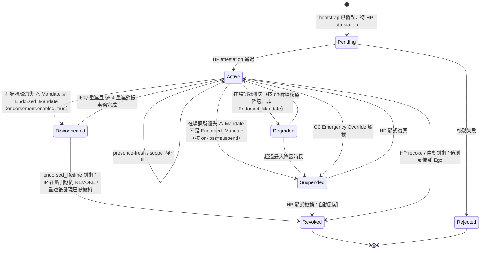

> 協定正文導航：[章節目錄](./README.md) ｜ 上一章 [§3 元件與介面](./03-元件與介面.md) ｜ 下一章 [§5 協定封包](./05-協定封包.md)

## §4 Data Models

本章定義協定的核心資料模型，分三節：

- **§4.1 TypeScript 人讀視圖（Non-normative）**——面向協定委員會、SDK 實作者與審閱者的人讀骨架；
- **§4.2 CDDL 權威定義（Normative）**——CBOR 主格式的權威 schema，所有線上位元組均以本節為準；
- **§4.3 Mandate 狀態機**——含 `Disconnected` 狀態、遷移觸發條件矩陣與「Mandate 狀態 ↔ Fay 行為狀態」映射表。

> **權威性宣告**：當 §4.1 的 TypeScript 視圖與 §4.2 的 CDDL 出現任何不一致，**以 §4.2 CDDL 為準**。§4.1 僅用於人讀，不進入線上簽章輸入；§4.2 的 Deterministic CBOR 編碼是簽章輸入的唯一來源（詳見 §6 Cryptography）。
>
> **Endorsement 欄位不可篡改性**：`endorsement` 子結構作為 `mandate` 的欄位進入簽章輸入，對其任一子欄位（`enabled` / `endorsed-scope` / `endorsed-grade` / `endorsed-lifetime-ms` / `offline-revocation-policy`）的事後篡改都會破壞 Mandate 簽章校驗（與 Requirement 11.1 第 3 條、§6.3 一致）。

### §4.1 核心型別（TypeScript 視圖，Non-normative）

下方 TypeScript 區塊以人讀形式給出 FayID / Grade / Scope / Mandate / Endorsement / PresenceRequirement / PresenceSignal / Attestation 等核心型別；權威定義見 §4.2。

```typescript
type FayID = string          // 形如 "fay:01HX...Z" 的 ULID-like
type HumanPrimeID = string   // 形如 "hp:..."（可錨定到 WebAuthn credentialId）
type MandateID = string      // ULID
type Nonce = Uint8Array      // 16 bytes random

/** 授權等級 */
enum Grade {
  EmergencyOverride = 0,  // G0
  Strict            = 1,  // G1
  Moderate          = 2,  // G2
  Loose             = 3,  // G3
  Autonomous        = 4   // G4
}

/** 授權範圍（least-privilege） */
interface Scope {
  domains:    string[]    // 允許存取的資源域（URL pattern / SPIFFE-ID-like）
  actions:    string[]    // 允許的動作（read / write / control:drone:takeoff …）
  terminals?: string[]    // 允許的終端集合（Phase 2 派生用）
  budget?:   ResourceBudget
}

interface ResourceBudget {
  time_window:    [IsoTime, IsoTime]
  max_invocations?: number
  max_cost_units?:  number  // 抽象資源單元（金額 / 推理量 / 流量等）
}

/** Mandate（替代 token） */
interface Mandate {
  version:       "Faying Protocol/1.0"
  id:            MandateID
  issued_at:     IsoTime
  not_before:    IsoTime
  not_after:     IsoTime          // 必須有限：無限期 Faying 是反模式
  issuer:        HumanPrimeID     // HP（也可以是其授權的 MS）
  ms_id:         string           // 實際簽發的 MS
  subject:       FayID            // 被授權的 iFay
  scope:         Scope
  grade:         Grade
  presence_req:  PresenceRequirement
  parent?:       MandateID        // 派生時指向父 Mandate
  endorsement?:  Endorsement      // 可選：背書式授權（Endorsed Mandate）
  attestation:   Attestation
  signature:     SignatureBundle  // 見 §6
}

/** 背書式授權（Endorsed Mandate）—— 離線自治的預先承擔
 *
 * 當且僅當 `enabled = true` 時，iFay 在物理 Faying 狀態斷開期間
 * 仍可在 endorsed_scope ⊆ scope、endorsed_grade.autonomy ≤ grade.autonomy
 * 範圍內自治；endorsed_lifetime 必須有限。責任承接端始終為 issuer（Human Prime）。
 */
interface Endorsement {
  enabled:                    boolean
  endorsed_scope:             Scope        // ⊆ Mandate.scope
  endorsed_grade:             Grade        // .autonomy ≤ Mandate.grade.autonomy
  endorsed_lifetime_ms:       number       // ≤ (not_after - not_before)
  offline_revocation_policy:  "stop-and-audit" | "stop-only" | "graceful-stop"
}

/** Scope.actions 註釋：協定層禁止使用萬用字元 / 前綴匹配（參見 §9 T2 Atomic_Action 強約束）。 */

/** 在場要求（綁定到 grade） */
interface PresenceRequirement {
  signal_types:   PresenceSignalType[]
  max_staleness_ms: number     // 超過即觸發降級
  on_loss:        OnLossPolicy // "downgrade-to:G2" | "suspend" | "emergency-override"
}

/** 在場訊號 */
interface PresenceSignal {
  mandate_id:     MandateID
  signal_type:    PresenceSignalType
  produced_at:    IsoTime
  nonce:          Nonce
  device_id:      string
  device_attestation: Attestation
  signature:      SignatureBundle
}

/** 證言（統一的可驗證斷言載體） */
interface Attestation {
  format:        "webauthn" | "tpm-quote" | "platform-keystore" | "self-signed"
  payload:       Uint8Array       // 各 format 自描述
  signer:        string           // public key id
  signature:     SignatureBundle
}
```

### §4.2 CDDL（CBOR 主格式，權威定義）

下方 CDDL 區塊為 Faying Protocol/1.0 線上格式的**權威 schema**。本協定規範的官方測試向量（`vectors/`）與互通合規測試套件（`conformance/`）均以本節為準；任何實作的 CBOR 位元組解碼結果必須與本節定義完全一致。

```cddl
; Faying Protocol/1.0 — CBOR Data Definition Language
; Normative; this is the authoritative schema for Faying Protocol/1.0 wire format.
faying-grade = 0..4    ; 0=EmergencyOverride, 1=Strict, 2=Moderate, 3=Loose, 4=Autonomous

scope = {
  domains:    [* tstr],
  actions:    [* tstr],
  ? terminals: [* tstr],
  ? budget:   resource-budget
}

resource-budget = {
  time-window:        [iso-time, iso-time],
  ? max-invocations:  uint,
  ? max-cost-units:   uint
}

iso-time = #6.0(tstr)   ; CBOR tag 0 (RFC 3339 string)

presence-signal-type =
  "webauthn-uv-fresh" /
  "face-continuous"   /
  "fingerprint-tap"   /
  "presence-heartbeat-only" /
  "intent-ticket"

presence-requirement = {
  signal-types:        [+ presence-signal-type],
  max-staleness-ms:    uint,
  on-loss:             tstr            ; "downgrade-to:Gx" | "suspend" | "emergency-override"
}

attestation = {
  format:    "webauthn" / "tpm-quote" / "platform-keystore" / "self-signed",
  payload:   bstr,
  signer:    tstr,
  signature: signature-bundle
}

signature-bundle = {
  alg:       "Ed25519" / "ES256" / "ML-DSA-65",   ; PQC 協商位
  pubkey:    bstr,
  sig:       bstr,
  ? chain:   [* bstr]                              ; 可選憑證鏈
}

mandate = {
  version:        "Faying Protocol/1.0",
  id:             tstr,
  issued-at:      iso-time,
  not-before:     iso-time,
  not-after:      iso-time,
  issuer:         tstr,        ; Human Prime ID
  ms-id:          tstr,
  subject:        tstr,        ; FayID
  scope:          scope,
  grade:          faying-grade,
  presence-req:   presence-requirement,
  ? parent:       tstr,
  ? endorsement:  endorsement,
  attestation:    attestation,
  signature:      signature-bundle
}

endorsement = {
  enabled:                       bool,
  endorsed-scope:                scope,         ; 必須 ⊆ 主 Mandate.scope
  endorsed-grade:                faying-grade,  ; 必須 ≤ 主 Mandate.grade（自主性更弱或相等，安全性更高）
  endorsed-lifetime-ms:          uint,          ; 必須 ≤ (mandate.not-after - mandate.not-before)
  offline-revocation-policy:     "stop-and-audit" / "stop-only" / "graceful-stop"
}

presence-signal = {
  mandate-id:           tstr,
  signal-type:          presence-signal-type,
  produced-at:          iso-time,
  nonce:                bstr .size 16,
  device-id:            tstr,
  device-attestation:   attestation,
  signature:            signature-bundle
}
```

> **欄位命名映射**：CDDL 使用 `kebab-case`（線上格式約定），TypeScript 視圖使用 `snake_case`（人讀約定）。兩者欄位一一對應：`presence-req` ↔ `presence_req`、`endorsed-scope` ↔ `endorsed_scope`、`endorsed-lifetime-ms` ↔ `endorsed_lifetime_ms` 等。

### §4.3 Mandate 狀態機



**`Disconnected` 狀態語意**：僅適用於 Endorsed_Mandate（即 `endorsement.enabled = true`）。處於該狀態時：

- iFay_Instance 僅允許在 `endorsement.endorsed_scope` 內、按 `endorsement.endorsed_grade` 約束執行 D 維度行為；
- 超出 `endorsement.endorsed_lifetime` 立即軟逾時 → 遷移到 Revoked，即使 iFay 仍處於物理斷開；
- HP 在斷開期間發起的 REVOKE 在 iFay 重連後立即按 `endorsement.offline_revocation_policy` 處理（預設 `stop-and-audit`）；
- 重連必須經 §8.4 對帳事務，禁止「靜默續傳」。

**遷移觸發條件矩陣**（與 §3.5 Liveness Channel、Requirement 11 / 12 連動）：

| 遷移 | 觸發條件 |
| --- | --- |
| Active → Degraded | `PresenceState.stale=true` ∧ Mandate 不是 Endorsed_Mandate ∧ `on-loss = "downgrade-to:Gx"` |
| Active → Disconnected | `PresenceState.stale=true` ∧ Mandate 是 Endorsed_Mandate（`endorsement.enabled=true`） |
| Active → Suspended | `PresenceState.stale=true` ∧ Mandate 不是 Endorsed_Mandate ∧ `on-loss = "suspend"` |
| Disconnected → Active | iFay 重連且 §8.4 重連對帳事務完成（含 Presence 復原 / 待處理 REVOKE / GRADE_SWITCH 全部對齊） |
| Disconnected → Revoked | `endorsed_lifetime` 到期 ∨ HP 在斷開期間 REVOKE ∨ 重連發現已被撤銷 |

**Mandate 狀態 ↔ Fay 行為狀態映射**（與第 13 章 A/B/C/D 維度對齊）：

| Mandate 狀態 | 等價的 Fay 行為狀態 | D 維度（對外行動） |
| --- | --- | --- |
| Pending | Rogue Fay | 禁止 |
| Active | Faying State | 允許（在 scope 內） |
| Degraded | Faying State（受限） | 僅允許當前降級等級 scope 內 |
| Disconnected | Faying State（endorsed-only） | 僅允許 `endorsement.endorsed_scope` 內、按 `endorsement.endorsed_grade` 約束（詳見 §7.5 / §8.4） |
| Suspended | Faying State 暫停 | 禁止，但保持 Mandate 可復原 |
| Revoked | Rogue Fay | 禁止 |
| Rejected | Rogue Fay | 禁止 |
