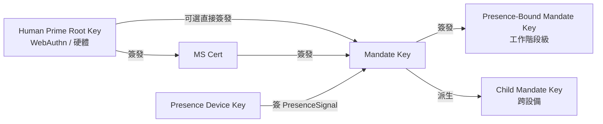

> 協定正文導航：[章節目錄](./README.md) ｜ 上一章 [§5 協定封包](./05-協定封包.md) ｜ 下一章 [§7 授權等級](./07-授權等級.md)

## §6 Cryptography

本章規定協定的密碼學部分，分三節：

- **§6.1 演算法套件**：預設 / 備選 / PQC 三檔演算法協商表與協商規則；
- **§6.2 金鑰派生與角色**：從 Human Prime Root Key 到 Presence-Bound Mandate Key 的派生關係與硬約束；
- **§6.3 簽章格式**：detached signature、Deterministic CBOR 簽章輸入、多簽鏈以及 Endorsed_Mandate 的簽章輸入錨點。

> **EARS 追溯說明**：本章每條規則後以 `Trace:` 列出其對應的 EARS 子條款編號（出處見本規範需求基線），形式為 `R<requirement>.<criterion>.<clause>`。

### §6.1 演算法套件

| 用途 | 預設 | 備選 | PQC 協商位 |
| --- | --- | --- | --- |
| 簽章（Mandate / Presence / Attestation） | **Ed25519** | ECDSA-P256 | ML-DSA-65（FIPS 204） |
| 雜湊 | **SHA-256** | BLAKE3 | SHA3-256 |
| 派生（KDF） | HKDF-SHA-256 | — | HKDF-SHA3-256 |
| 對稱（如啟用 Mandate stapling 加密） | ChaCha20-Poly1305 | AES-256-GCM | — |
| 通道層 | TLS 1.3 mandatory | mTLS optional | TLS-1.3-PQ（hybrid X25519 + ML-KEM-768） |

**協商規則**：

- **N1（雙方各自宣告）**：用戶端與伺服器端必須在 BOOTSTRAP 時各自宣告其所支援的簽章、雜湊、KDF、對稱、通道層演算法套件；`SignatureBundle.alg`、`hash`、`kdf`、`channel-suite` 的最終值必須是雙方共同支援的最強演算法。
  - **Trace**：`R8.1.1`（BOOTSTRAP 時各自宣告所支援演算法套件）、`R8.1.2`（選擇雙方共同支援的最強演算法作為最終值）。

- **N2（最低實作集合）**：所有相容實作必須至少同時支援簽章演算法集合 `{Ed25519, ECDSA-P256}`；PQC 套件作為 OPTIONAL 但所有實作必須保留協商位以便未來滾動升級。
  - **Trace**：`R8.1.3`（至少同時支援 `{Ed25519, ECDSA-P256}`）、`R8.2.3`（PQC 套件被標記為 `MUST` 之前實作為 `OPTIONAL`，且不得因對端不支援 PQC 而拒絕 BOOTSTRAP）。

- **N3（無共同套件 → `E_PROTOCOL`）**：若雙方在 BOOTSTRAP 時不存在任一共同支援的簽章演算法或雜湊演算法，Mandate_Service 必須以 `E_PROTOCOL` 拒絕該次 BOOTSTRAP。
  - **Trace**：`R8.1.4`（無共同演算法時以 `E_PROTOCOL` 拒絕 BOOTSTRAP）。

- **N4（PQC 協商位預留與可滾動升級）**：`Mandate.signature_bundle` 必須提供演算法位以支援 `ML-DSA-65`（FIPS 204）作為可選簽章演算法；BOOTSTRAP 協商位中必須預留對 `TLS-1.3-PQ`（hybrid X25519 + ML-KEM-768）的可選支援；協定必須允許在生命週期內透過版本協商將預設演算法套件滾動升級，且不破壞既有 Mandate 的可校驗性。
  - **Trace**：`R8.2.1`（`Mandate.signature_bundle` 提供 `ML-DSA-65` 演算法位）、`R8.2.2`（BOOTSTRAP 協商位預留 `TLS-1.3-PQ`）、`R8.2.4`（版本協商滾動升級且不破壞既有 Mandate 可校驗性）。

### §6.2 金鑰派生與角色

下圖給出 Faying Protocol 的金鑰派生層次與角色關係：HP Root Key 永遠不離開人類持有的硬體，僅授權 MS Key 與（在受限路徑下）Mandate Key；Mandate Key 在簽發 Presence-Bound 與 Child Mandate Key 時建立短壽命工作階段金鑰，Presence_Device Key 僅用於簽 PresenceSignal。



**關鍵約束**：

- **K1（HP Root Key 的硬體錨定）**：HP Root Key 永遠不離開人類持有的硬體（WebAuthn authenticator / 平台 keystore / 硬體錢包）；任何要求 HP Root Key 離開硬體的密碼學路徑在協定層不存在。
  - **Trace**：`R9.2.4`（每個 Mandate 使用獨立的、短壽命的工作階段簽章金鑰——蘊含根金鑰與工作階段金鑰分離的金鑰層次約束）、`R8.1.3`（最低實作集合的硬體可承載性）。

- **K2（撤銷鏈的方向性）**：MS Key 的撤銷由 HP Root Key 直接執行；MS 自己不能撤銷自己。該約束保證撤銷可達性的根錨定在 HP，而非 MS 自身。
  - **Trace**：`R9.2.4`（Presence-Bound Mandate Key 在每次 GRADE_SWITCH 時強制 rotate——蘊含 MS 不可自我撤銷根金鑰的反向約束）。

- **K3（每 Mandate 獨立工作階段金鑰）**：每個 Mandate 擁有獨立的工作階段簽章金鑰（避免長壽命金鑰被濫用）；Presence-Bound Mandate Key 在每次 GRADE_SWITCH 時強制 rotate。
  - **Trace**：`R9.2.4`（每個 Mandate 使用獨立的、短壽命的工作階段簽章金鑰；每次 GRADE_SWITCH 強制 rotate Presence-Bound Mandate Key）。

- **K4（設備綁定的派生路徑）**：Child Mandate Key 必須綁定到目標設備的 `device_id` 與 `device_attestation`；任何「複製 Mandate 到另一終端直接使用」的路徑必須被拒，要求其改走 DELEGATE 流程。
  - **Trace**：`R9.2.1`（頒發時綁定 `device_id` 與 `device_attestation`）、`R9.2.2`（在另一終端上使用同一 Mandate 必須改走 DELEGATE）。

- **K5（Channel Binding）**：當 mTLS 被啟用時，Mandate 必須攜帶由 [RFC 9266](https://www.rfc-editor.org/rfc/rfc9266) 定義的 TLS Exporter 通道綁定值，且 Relying_Party 必須在校驗階段比對該值。
  - **Trace**：`R9.2.3`（mTLS 啟用時攜帶 RFC 9266 TLS Exporter 通道綁定，且 RP 必須比對）。

### §6.3 簽章格式

**S1（Detached signature）**：全部使用 detached signature——CBOR `signature_bundle` 與 payload 分離，便於稽核與重簽。`signature_bundle` 不得內嵌 payload 自身或其副本。
- **Trace**：`R10.2.2`（detached signature，`signature_bundle` 與 payload 分離）。

**S2（簽章輸入的規範化定義）**：所有簽章物件必須按 [RFC 8949 §4.2.1 Deterministic Encoding](https://www.rfc-editor.org/rfc/rfc8949#section-4.2.1) 規則排序後再簽章；簽章輸入必須計算為：

> `signature_input = H( Deterministic-CBOR( Envelope_without_signature ) )`

其中 `H` 即協商最終的雜湊演算法（預設 SHA-256，備選 BLAKE3，PQC 協商位 SHA3-256），`Envelope_without_signature` 表示從 `Faying Protocol Envelope` 中剔除 `signature_bundle` 欄位後的剩餘結構。**該公式適用於本協定中所有需要簽章的物件**（含 Mandate、PresenceSignal、Faying Protocol Envelope 自身），並使簽章輸入不依賴 JSON 序列化的歧義——CBOR 與 JSON 兩種編碼下的簽章輸入雜湊必須相同。

- **Trace**：`R10.2.1`（按 RFC 8949 §4.2.1 Deterministic Encoding 規則排序後再簽章）、`R10.2.4`（簽章輸入為 `H( Deterministic-CBOR(Envelope_without_signature) )`）、`R10.1.4`（簽章前先做 Deterministic CBOR 序列化使簽章輸入不依賴 JSON 序列化的歧義）。

**S3（多簽鏈）**：在多簽場景下（如 DELEGATE 需父 Mandate 副簽），父鏈簽章透過 `signature_bundle.chain` 陣列承載；鏈元素的順序為「子 → 父 → 父之父 → … → 根」，且每個鏈元素自身亦遵循 S2 的簽章輸入規範化。
- **Trace**：`R10.2.3`（多簽場景下透過 `signature_bundle.chain` 陣列承載父鏈簽章）。

**S4（Endorsed_Mandate 簽章輸入錨點）**：當 Mandate 攜帶 `endorsement` 欄位（無論 `enabled` 真值），`endorsement` 的全部子欄位——

```
(enabled, endorsed_scope, endorsed_grade, endorsed_lifetime_ms,
 offline_revocation_policy)
```

——必須進入簽章輸入。即 `H( Deterministic-CBOR(Mandate_without_signature) )` 計算時**不得排除** `endorsement` 子樹。該規則與 P16.1（Endorsement_Signature_Inclusion）一致。

任何對 `endorsement` 欄位的事後篡改（含將 `enabled` 由 `false` 翻轉為 `true`、擴張 `endorsed_scope`、放鬆 `endorsed_grade`、延長 `endorsed_lifetime_ms`、修改 `offline_revocation_policy`）都將導致簽章校驗失敗：Relying_Party 以 `E_ATTESTATION_INVALID` 拒絕相關呼叫，Mandate_Service 以 `E_ENDORSEMENT_INVALID` 拒絕並觸發該 Mandate 的 Revoke（詳見 §5.4 錯誤碼 1013、§9.7、P16.1）。

- **Trace**：`R11.1.3`（每份 Endorsed_Mandate 的 `endorsement` 欄位進入簽章輸入，使任何事後篡改都會破壞簽章校驗）、`R11.1.4`（`endorsement` 欄位被偵測篡改時 RP 以 `E_ATTESTATION_INVALID` 拒絕並由 MS 觸發 Revoke）。

**S5（endorsement 欄位不可篡改性的推導）**：由 S2 與 S4 聯合得出——

1. 由 S4，`endorsement` 子樹必須進入 `Deterministic-CBOR(Mandate_without_signature)`；
2. 由 S2，簽章輸入為 `H(Deterministic-CBOR(Mandate_without_signature))`；
3. 因此對 `endorsement` 任一子欄位的修改都將改變 Deterministic CBOR 序列化結果，從而改變簽章輸入雜湊；
4. 由簽章驗章的密碼學性質，原簽章在新的簽章輸入上必校驗失敗。

故 `endorsement` 欄位的不可篡改性由 §6.3 直接推導得出，無需額外協定層機制。**該不可篡改性是 Endorsed_Mandate 責任歸屬鏈（詳見 §11.4 與 P16.5）的密碼學基石**：任何對 endorsement 的事後篡改都將在簽章校驗階段被立即發現，從而切斷「透過篡改背書宣告逃避責任承接」的所有可能路徑。

- **Trace**：`R11.1.3`（事後篡改破壞簽章校驗）、`R10.2.4`（簽章輸入定義）、`R11.1.4`（篡改被發現時的協定層處置）。
