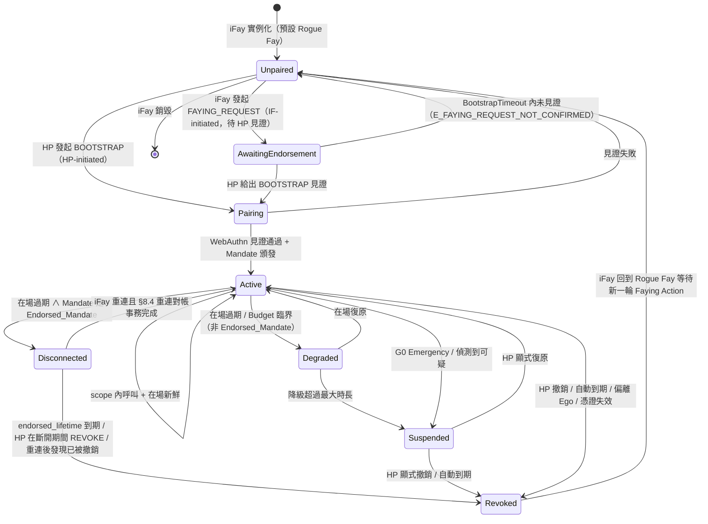
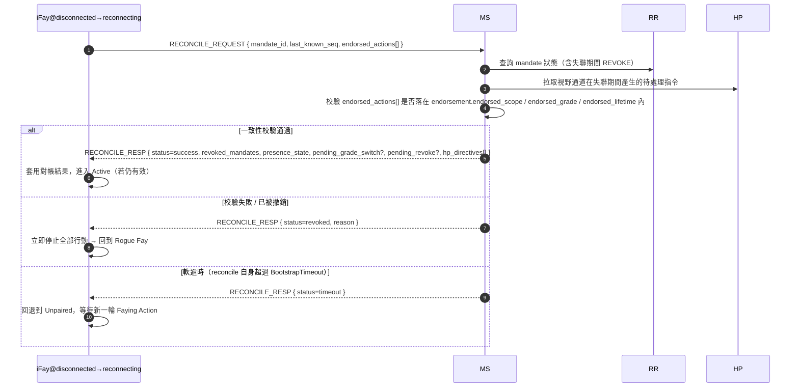

> 協定正文導航：[章節目錄](./README.md) ｜ 上一章 [§7 授權等級](./07-授權等級.md) ｜ 下一章 [§9 安全考量](./09-安全考量.md)

## §8 Lifecycle

本章講 iFay 的完整生命週期：從實例化、發起 Faying Action、維持 Faying State，到降級、失聯、暫停、撤銷，最後回到 Rogue Fay。這套狀態機承載了協定層的核心不變式——對外行動是否合法、責任端是否唯一、失聯期間能自治到什麼邊界，都由本章定義。

### §8.1 完整生命週期狀態機

下圖涵蓋協定層 7 個狀態閉包（**Unpaired / Pairing / Active / Degraded / Disconnected / Suspended / Revoked**）以及它們之間的全部合法遷移。`AwaitingEndorsement` 是 IF-initiated 雙向 Faying 路徑上的中間臨時態（詳見 §2.4 / §5.3.6），不構成「行動可執行」的穩定閉包，但仍出現在狀態圖中以保證遷移圖完備。

> 與 §4.3 Mandate 狀態機的關係：§4.3 描述 *Mandate 物件* 的狀態（Pending / Active / Degraded / Disconnected / Suspended / Revoked / Rejected），本節描述 *iFay 實體* 的生命週期狀態。兩者透過「Active/Degraded/Disconnected Mandate ⇔ Faying State / endorsed-only Faying State」映射銜接；詳見 §4.3 末尾的「Mandate 狀態 ↔ Fay 行為狀態映射」表。

### §8.2 階段語意

下表給出 7 個狀態閉包的語意。每個狀態在「對外行動（D 維度）」列上的取值即為協定層的 D 維度准入決策。

- **Unpaired**：與藍圖 Rogue Fay 等價。僅允許 A1–A4（自我感知）、B1–B3（對內表達）、C1–C2（對人單向溝通，含 FAYING_REQUEST 發起）維度行為。D 維度一律禁止。

> **Rogue Fay 的精確判定（重要）**：連接斷開本身**不等於** Rogue Fay。一個 iFay 被認定為 Rogue Fay，當且僅當滿足下列兩類情形之一：（1）**斷開連接且不存在任何明確授權**——即沒有任何處於 `Active / Degraded / Disconnected` 的 Mandate 涵蓋其當下行為（含從未建立 Faying、Mandate 已撤銷 / 過期 / 被暫停）；（2）**已被證明失聯**——按 §9.9 被判定為 Perceived-Disconnected（感知失聯），且當前 Mandate 不是有效 Endorsed_Mandate（或 `endorsement` 已到期 / `enabled=false`）。
>
> 反過來說：物理連接雖斷、但持有**有效 Endorsed_Mandate** 且仍在 `endorsed_scope / endorsed_grade / endorsed_lifetime` 內的 iFay，處於 `Disconnected` 狀態，屬於 **Faying State（endorsed-only）而非 Rogue Fay**——其斷開期間的 D 維度行為由 `Mandate.issuer`（HP）在 BOOTSTRAP 階段的離線預授權承接（詳見 §4.3 / §7.5 / §8.3 / §8.4）。僅當背書壽命到期、被撤銷、或對帳失敗時，該 iFay 才遷移到 Revoked → Unpaired，回到 Rogue Fay。
- **AwaitingEndorsement**：iFay 發起的 FAYING_REQUEST 已轉交 HP 視野通道，等待 HP 在 `BootstrapTimeout`（預設 60s）內透過 BOOTSTRAP 給出認可確認；該狀態不產生任何 Mandate，對外行動一律禁止；逾時即回退到 Unpaired 並寫入 Attestation Chain（錯誤碼 1014 `E_FAYING_REQUEST_NOT_CONFIRMED`）。
- **Pairing**：Faying Action 進行中，臨時態。必須在 `BootstrapTimeout` 內完成 WebAuthn 見證 + Mandate 簽發；失敗即回退到 Unpaired，無殘留狀態。
- **Active**：Faying State 正常執行。存在唯一一個 Active 狀態的 Mandate 與之對應；所有 D 維度呼叫按 `Mandate.scope` 與 `Mandate.grade` 准入。
- **Degraded**：Faying State 仍成立但等級被收緊（在場訊號過期觸發）。僅適用於**非 Endorsed_Mandate**。持續時長不可超過 `MaxDegradedDuration`（預設按 grade 配置，見附錄 B）；超過即遷移到 Suspended。
- **Disconnected**：Faying State 僅在 `endorsement.endorsed_scope` 與 `endorsement.endorsed_lifetime` 內有效；適用於 Endorsed_Mandate 在物理失聯期間的「endorsed-only」行為視窗。具體准入與失聯語意詳見 §4.3 / §7.5 / §8.4。
- **Suspended**：Faying State 臨時掛起。對外行動一律禁止，但 Mandate 中繼資料保留以便 HP 顯式復原或稽核；超過自動到期點即遷移到 Revoked。
- **Revoked**：Mandate 終止。iFay 回到 Rogue Fay；任何後續 D 維度呼叫必須經過新一輪完整 Faying Action（新 `mandate_id`）。Revoked 是 Mandate 的吸收態（詳見 P10）。

### §8.3 責任歸屬時序

> **任意時刻 IF 的對外行動 → 必須存在唯一一個 Active、Degraded 或 Disconnected 的 Mandate → 該 Mandate 的 `issuer` 即責任承接端。**

本款是協定層「責任承接端唯一性」的形式化時序條款，不存在第三種情形：

1. **不存在合規 Mandate**：沒有任何處於 Active / Degraded / Disconnected 的 Mandate ⟹ 不允許對外行動（D 維度被禁），RP 必須返 `E_NO_MANDATE`（1001）或 `E_PRESENCE_STALE`（1005）。
2. **多個合規 Mandate 並存**：協定層強制選擇「最具體作用域」的一個，且必須共享同一 `issuer`（HP）；若存在不同 issuer 的多個合規 Mandate，視為協定錯誤，必須返 `E_PROTOCOL`（1099）。
3. **Disconnected 期間的對外行動**：同樣歸責於 `Mandate.issuer`（HP）。`endorsement` 僅約束行動可執行的 `endorsed_scope` / `endorsed_grade` / `endorsed_lifetime`，不改變責任承接端；不存在「由 endorsement 把責任轉移到 iFay 自己 / MS / Supervisory Agent」的合法路徑（詳見 P16.5）。

由本款立刻可推得：

- 任何被接受的呼叫 `c`，其稽核五元組 `(mandate_id, endorsement_id?, action, ts, signature_chain)` 中 `signature_chain` 的根節點必為且僅為 `Mandate.issuer`；
- iFay 不存在「自我歸責」的合法路徑，MS / Supervisory Agent 亦不得以代理見證替代 HP 的 `issuer` 身分；
- 責任承接端在 Mandate 生命週期內不可變更；如需變更必須經撤銷 + 新 BOOTSTRAP（新 `mandate_id`、新 `issuer`）。

### §8.4 重連對帳（Reconciliation）

> **目的**：把 iFay 在 Disconnected 期間的「endorsed 自治」與協定中心視圖（MS / RR / HP 視野通道）的狀態變化收斂到一致，並把「重連即可繼續行動」作為反模式顯式禁止。

#### §8.4.1 流程

#### §8.4.2 對帳事務返回內容

事務成功（`status = success`）時，`RECONCILE_RESP` 必須返回以下欄位（與 Requirement 12.4 一一對應）：

1. **`revoked_mandates`**：失聯期間被撤銷的 Mandate 列表（含級聯子 Mandate）；
2. **`presence_state`**：當前 PresenceState（用於決定是否可繼續 D 維度）；
3. **`pending_grade_switch`**：未完成的 GRADE_SWITCH 事件（如有）；
4. **`pending_revoke`**：未完成的 REVOKE 事件（如有）；
5. **`hp_directives`**：HP 視野通道在失聯期間產生的待處理指令（如 G0 Emergency Override、顯式 REVOKE、強制降級等）。

#### §8.4.3 事務結局列舉

對帳事務的結局為且僅為下列三種之一，與 P17.4 `reconcile_result(M) ∈ {success, revoked, timeout}` 形式化定義一致：

| 結局 | 觸發條件 | 後置狀態 | 稽核要求 |
| --- | --- | --- | --- |
| `success` | 一致性校驗通過 ∧ Mandate 仍有效 ∧ 在 BootstrapTimeout 內完成 | Disconnected → Active | 寫入 Attestation Chain，含 endorsed_actions 完整稽核 |
| `revoked` | endorsed_lifetime 已到期 ∨ HP 在斷開期間發起 REVOKE ∨ 重連後發現已被撤銷 ∨ endorsed_actions 越界 | Disconnected → Revoked → Unpaired | 寫入 Attestation Chain，按 `endorsement.offline_revocation_policy` 處理失聯期間稽核 |
| `timeout` | 對帳事務自身超過 `BootstrapTimeout` 仍未達成 success / revoked | Disconnected → Unpaired | 寫入 Attestation Chain，標記 `reason=reconcile-timeout` |

#### §8.4.4 協定層硬約束

- **D 維度禁令**：對帳事務未完成前，iFay 禁止任何 D 維度行動；任何在該視窗內到達 RP 的呼叫必須以 `E_PRESENCE_STALE`（1005）或 `E_REVOKED`（1006）拒絕。該禁令在 `[t_reconnect, t_reconnect + reconcile_complete_ms]` 區間內成立（與 P17.4 一致）。
- **逾時即退回 Rogue Fay**：對帳事務必須在 `BootstrapTimeout` 內完成；逾時即 iFay 退回 Unpaired，等待新一輪 Faying Action（不允許自動重試 BOOTSTRAP）。
- **三種結局必入 AC**：對帳事務自身的 `success` / `revoked` / `timeout` 三種結局都必須寫入 Attestation Chain，並按 `endorsement.offline_revocation_policy` 處理失聯期間的行動稽核：
  - `stop-and-audit`（預設）：立即停止 + 提交完整 endorsed_actions 稽核 + 退回 Rogue Fay；
  - `stop-only`：立即停止 + 不強制稽核（僅適用於不可逆 / 緊急場景，需協定委員會決議）；
  - `graceful-stop`：允許有限收尾（寫關閉 / 狀態保存）後停止，收尾動作仍受 endorsement 約束。
- **失敗回退後不得自重試**：對帳事務結局為 `revoked` 或 `timeout` 而回退到 Rogue Fay 時，iFay 不得自行重試 BOOTSTRAP，必須等待 HP 重新發起（HP-initiated）或經 HP 顯式認可的新 FAYING_REQUEST（IF-initiated）。
- **靜默續傳禁止**：禁止任何「重連即繼續」的實作路徑。任何繞過 §8.4 對帳事務直接把 Disconnected 遷移到 Active 的實作，均視為不合規實作，互通合規測試套件必須將其判定為 fail。
