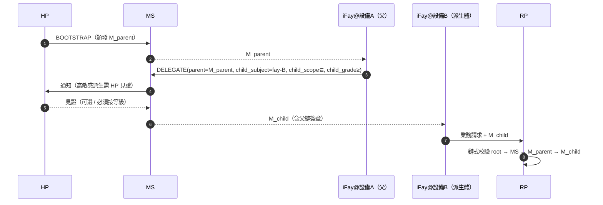

> 協定正文導航：[章節目錄](./README.md) ｜ 上一章 [§8 生命週期](./08-生命週期.md) ｜ 下一章 [§10 錯誤處理](./10-錯誤處理.md)

## §9 Security Considerations

本章把 Faying Protocol 在 AI Agent 時代要面對的攻擊面收斂成協定層的硬約束。以 STRIDE 打底，逐項展開：抗重放（§9.2）、抗劫持（§9.3，含 RFC 9266 Channel Binding）、抗釣魚（§9.4，含 `Faying_Initiation` 錨點）、脫鉤態辨識（§9.5，4+1 類訊號 ≤60s 可觀測）、責任歸屬一致性（§9.6）、跨設備派生信任傳遞（§9.7，含 endorsement 派生收斂）、失聯處理矩陣（§9.8 / §9.9），以及 AI 時代對抗威脅目錄（§9.10，T1–T7）。每條威脅都回鏈到本規範正確性屬性與 EARS 子條款。

### §9.1 STRIDE 威脅模型

| 類別 | 威脅 | Faying Protocol 緩解 |
| --- | --- | --- |
| **S**poofing | 攻擊者冒充 HP 發起 BOOTSTRAP | WebAuthn UV + HP Root Key 硬體錨定；每次 BOOTSTRAP 必走 user-verification |
| **S**poofing | 攻擊者冒充 iFay 攜偽 FayID 呼叫 | Mandate 與 FayID 強綁定 + Attestation Chain 可獨立校驗 |
| **T**ampering | 中間人篡改 Mandate / Presence | TLS 1.3 + 端到端簽章（detached）+ Deterministic CBOR |
| **R**epudiation | HP 否認曾發起 Faying Action | Attestation Chain + Audit Log 雙錨定，HP 見證不可抵賴 |
| **I**nformation Disclosure | 攻擊者截獲 Mandate 推斷 HP 行蹤 | Mandate 不暴露 HP 即時座標；位置類訊號（B4）協定層保留為可選 |
| **D**oS | 攻擊者刷 PRESENCE 封包 | nonce 抗重放 + 速率限制 + 設備 attestation 准入 |
| **E**levation of Privilege | iFay 自我升級 grade | 協定硬約束：升級方向必須 HP `human_witness` |

### §9.2 抗重放

- 每個封包的 `nonce` 16-byte random + `issued_at` 雙重判斷。
- MS / RP 各自維護 `(subject, nonce) seen-set`，TTL = `2 × max_message_lifetime`。
- 任何重複 nonce → `E_REPLAY`（1009）+ 安全告警；該錯誤碼同時強制入稽核鏈與 HP 視野通道（詳見 §10 EH.3）。

### §9.3 抗劫持（Mandate 盜用）

- **設備綁定**：每個 Mandate 在頒發時綁定到 iFay 實例的 `device_id` + `device_attestation`，跨設備呼叫必須走 DELEGATE 流程（詳見 §9.7）。
- **工作階段金鑰**：每個 Mandate 的簽章金鑰獨立、短壽命（詳見 §6.2）。
- **Channel Binding**：Mandate 在 mTLS 啟用時必須額外攜帶 TLS Exporter（[RFC 9266 — Channel Bindings for TLS 1.3](https://www.rfc-editor.org/rfc/rfc9266)）以阻止「Mandate 被剝離到另一個 TLS 通道」的攻擊。Channel Binding 值進入簽章輸入（與 §6.3 Deterministic CBOR 簽章輸入一致），任何 TLS 通道與簽章 Channel Binding 不一致的請求一律以 `E_ATTESTATION_INVALID`（1007）拒絕。

### §9.4 抗釣魚

- BOOTSTRAP 必須由 HP 在持有 Presence Device 的語境下發起，攻擊者無法透過遠端連結誘騙 HP 同意。
- WebAuthn 的 `origin` 綁定阻止跨域釣魚。
- 跨設備派生（DELEGATE）攜帶「父 Mandate 副簽」防止單一 MS 被攻陷後批次偽派生（詳見 §9.7）。

**`Faying_Initiation` 抗釣魚錨點**：iFay 主動發起的 `FAYING_REQUEST`（IF-initiated 路徑，詳見 §2.4 Phase A0、§5.3.6）**不直接產生** Faying 狀態變化——僅作為轉交封包進入 HP 視野通道；HP 必須以 BOOTSTRAP（攜 `human_witness`）顯式認可才能生效。這一架構使「偽造 iFay 尋 Faying」在協定層無法繞開 HP 見證；任何缺失或偽造 `human_witness` 的 BOOTSTRAP 一律以 `E_HUMAN_WITNESS_REQUIRED`（1010）拒絕。`FAYING_REQUEST` 本身的頻次受 `ConfirmationRateLimit` 約束（詳見 §9.10.7 T6 與附錄 B），以阻斷「借合法尋 Faying 通道實施確認洪流」的濫用面。

### §9.5 脫鉤態（Rogue / 失聯）辨識

> **4 + 1 類脫鉤訊號必須能在 ≤ 60s 內被 RP 與 HP 同時觀測到。** 下表前 4 類（主動 / 被動 / 異常 / 失聯）與 `RevokeReason` 列舉一一對應，第 5 類（偏離）以 `RevokeReason="ego-deviation"` 收斂，同樣可被 RP 與 HP 在 60s 內觀測。

| # | 訊號型別 | 觸發條件 | 協定回應 | 對應 RevokeReason |
| --- | --- | --- | --- | --- |
| 1 | 主動脫鉤 | HP 顯式 REVOKE | RR 即刻廣播；IF 收到 REVOKE-NOTIFY 立即停止 D 維度 | `human-initiated` |
| 2 | 被動脫鉤 | Presence 過期超過 max-staleness | 自動降級 → Suspended → 觸發 Revoke（非 Endorsed_Mandate 路徑） | `terminal-disconnected` |
| 3 | 異常脫鉤 | Attestation Chain 任一節點失效 | 立即 Revoke + 安全告警 | `fay-credential-invalid` |
| 4 | 失聯脫鉤 | HP 不可聯繫超過閾值（`HumanReachabilityBudget`） | 自動 Revoke | `human-prime-unreachable` |
| +1 | 偏離脫鉤 | RP / MS 偵測到 IF 行為偏離 Ego 邊界 | 立即 Revoke | `ego-deviation` |

**Endorsed_Mandate 在脫鉤辨識中的例外錨點**：當 `PresenceState.stale=true` 且當前 Mandate 是 Endorsed_Mandate（`endorsement.enabled=true`）時，IF 不立即進入 Suspended，而是遷移到 Disconnected（詳見 §3.5、§4.3、§7.5、§8.4）；Disconnected 期間 IF 僅允許在 `endorsement.endorsed_scope` / `endorsed_grade` / `endorsed_lifetime` 內自治。該例外不削弱對稱撤銷與責任歸屬唯一性：

- HP 在斷開期間發起的 REVOKE 仍為最高優先級；IF 在重連後必須按 `endorsement.offline_revocation_policy` 處理（詳見 §8.4）；
- `endorsement.endorsed_lifetime` 一到期，即使 IF 仍處於物理斷開，也必須立即軟逾時停止全部行動；
- 責任承接端始終為 `Mandate.issuer`（HP），不因 endorsement 存在而改變（詳見 §8.3、P16.5）。

**Disclosure_Report 與 ego-deviation 的協同**：iFay 在重連或彙報階段提交的 `DISCLOSURE` 封包（§5.3.7）若與實際動作不一致（強制欄位缺失 / 值與稽核鏈矛盾），MS 必須以 `RevokeReason="ego-deviation"` 撤銷該 Mandate，詳見 §9.10.4 T3。

### §9.6 責任歸屬一致性的協定級承諾

- 任意一次 RP 接受的對外呼叫，可在 audit-log 中以 `(mandate_id, issuer, subject, grade, presence_proof, ts)` 五元組無歧義還原責任端。
- 任意一次 RP 拒絕的呼叫，可還原拒絕原因碼（錯誤碼 §5.4）。
- 任意一次 Revoke 在 RR 上的可見性 ≤ `RevocationVisibilityBudget`（預設 1s，詳見附錄 B）。

### §9.7 跨設備派生的信任傳遞

派生硬約束：

- `M_child.scope ⊆ M_parent.scope`；
- `M_child.grade.autonomy ≤ M_parent.grade.autonomy`（子代理的自主性不高於父代理，即「子代理不允許比父更寬鬆」；等價於「子代理的安全性 ≥ 父代理」，詳見 §7、P6）；
- 父 Mandate 一旦 Revoke，所有 child cascade 失效（預設 `cascade=true`）。

**Endorsed Mandate 派生（DELEGATE）的 endorsement 收斂約束**：

當父 Mandate 是 Endorsed_Mandate 且 DELEGATE 子 Mandate 也宣告了 `endorsement` 時，子 endorsement 必須嚴格收斂於父 endorsement（與 P16.3 鎖定）：

- `child.endorsement.endorsed_scope ⊆ parent.endorsement.endorsed_scope`（且仍 ⊆ `child.scope`）；
- `child.endorsement.endorsed_grade.autonomy ≤ parent.endorsement.endorsed_grade.autonomy`（且仍 ≤ `child.grade.autonomy`）；
- `child.endorsement.endorsed_lifetime_ms ≤ parent.endorsement.endorsed_lifetime_ms`（且仍 ≤ `child.not_after − child.not_before`）；
- `child.endorsement.offline_revocation_policy` 不弱於父策略（不弱於 = 至少同樣嚴格；典型偏序：`stop-and-audit` ≥ `graceful-stop` ≥ `stop-only` 在「稽核完整性」維度上嚴格度遞減，DELEGATE 不允許向更弱方向鬆綁）；
- 若父 Mandate 不是 Endorsed_Mandate，則 child **不允許**宣告 `endorsement`（不允許「父無背書、子憑空獲得離線自治」）。

任何違反上述收斂規則的 DELEGATE 請求 → MS 必須以 `E_PROTOCOL`（1099）或 `E_ENDORSEMENT_INVALID`（1013）拒絕。

### §9.8 Disconnection Handling

> 把 §3.5 Liveness Channel 的「真實 / 感知」雙語意與 Mandate 狀態機收斂到協定層處理矩陣。**協定僅以「感知」作為決策依據，但必須顯式刻畫兩側不一致的行為後果**。

**4 種 (Actually × Perceived) 組合的協定層處理矩陣**：

| 真實狀態 | 感知狀態 | 協定層處理 | 狀態機遷移 | 責任歸屬 |
| --- | --- | --- | --- | --- |
| Connected | Connected | 正常路徑；按當前 grade 處理呼叫 | Active 維持 / Active → Degraded（按 budget 觸發） | 當前 Mandate.issuer |
| **Disconnected** | **Connected**（視窗 A：心跳間隔內的觀察盲區） | iFay 實際已斷；任何「在線推測」被視為危險面，協定必須按「如果當前請求依賴在場新鮮度」則拒絕；高敏感動作不允許在視窗 A 內被放行（§9.10 T1 / T4 主要利用面） | 維持 Active（直至下一次 Presence 校準觸發 stale） | 當前 Mandate.issuer（事後稽核若發現該視窗被濫用 → `ego-deviation`） |
| Connected | **Disconnected**（視窗 B：網路抖動 / 心跳丟包） | iFay 實際在線，但被感知失聯；按悲觀推定原則收斂——協定層一律按「已失聯」處理，禁止任何「反向樂觀」放行 | Active → Disconnected（若 Endorsed_Mandate）/ Active → Suspended（若非 Endorsed_Mandate） | 當前 Mandate.issuer |
| **Disconnected** | **Disconnected** | 協定層與現實一致；唯一允許的 D 維度路徑是 Endorsed_Mandate 在 endorsed_scope / endorsed_grade / endorsed_lifetime 範圍內自治 | Active → Disconnected（Endorsed）/ Active → Suspended（非 Endorsed） | 當前 Mandate.issuer |

**重連後收斂**：所有「感知失聯→感知在線」的遷移必須經 §8.4 重連對帳事務，禁止自動復原；對帳失敗 → Disconnected → Revoked → Rogue Fay。

**與 RR 不可達的正交關係**：RR 不可達（§3.4）與 iFay 失聯（§3.5）是兩類正交事件，處理矩陣：

| iFay 感知狀態 | RR 狀態 | 協定層處理 |
| --- | --- | --- |
| Connected | Available | 正常 |
| Connected | Unavailable | RP 拒絕呼叫（`E_RR_UNAVAILABLE`，1008），不影響 Mandate 狀態機 |
| Disconnected（Endorsed） | Available | iFay 在 endorsed_scope 內自治；本地無法查詢 RR，呼叫走 RP 時 RP 須獨立查詢 |
| Disconnected（Endorsed） | Unavailable | iFay 仍可在 endorsed_scope 內自治；但任何依賴 RR 的 RP 呼叫必須按 Default-Deny 拒絕 |

### §9.9 真實失聯與感知失聯的協定層定義（Disconnection Strategy 錨點）

> 本節集中刻畫 §3.5 Liveness Channel 與 §9.8 處理矩陣背後的兩套語意，作為 Requirement 12（Disconnection Strategy）的設計錨點。

**雙語意定義**（與 §3.5 一致）：

- **Actually_Disconnected（真實失聯）**：iFay_Instance 行程 / 網路 / 設備已經停止工作；屬於客觀物理事實，協定層不可直接觀測。
- **Perceived_Disconnected（感知失聯）**：在 MS / RP / HP 視角下，依據最近的 PresenceSignal、心跳與 RR 推送狀態，判定 iFay 已失聯；屬於協定層唯一可作為決策依據的語意。

**兩類不一致視窗**：

- **視窗 A — Actually-Disconnected ∧ Perceived-Connected**：iFay 實際已斷，但最近一次 PresenceSignal 仍在 `max_staleness_ms` 內 → 心跳間隔內的「觀察盲區」，是 §9.10 T1 / T4 的主要利用面。
- **視窗 B — Actually-Connected ∧ Perceived-Disconnected**：iFay 實際在線，但最近一次 PresenceSignal 已超過 `max_staleness_ms`（網路抖動 / 心跳丟包）→ 協定層以悲觀推定收斂。

**悲觀推定原則（統一收斂規則）**：

> **協定層僅以 Perceived-Disconnected 作為決策依據；任意「真實在線但被感知為失聯」的 iFay_Instance 不得據此豁免協定層的判定後果。** 在兩類不一致視窗內，協定必須按「更嚴格的那一側」處理；不存在「按更寬鬆的狀態處理」的合法路徑。

**LivenessDetectionBudget 上限**：

- 失聯探測視窗設有協定層硬上限 `LivenessDetectionBudget`，並按 grade 收緊（grade 數值越小、安全性越高 → 上限越短）；具體預設值見附錄 B。
- `Mandate.presence_req.max_staleness_ms` 不得超過當前 grade 對應的 `LivenessDetectionBudget`；BOOTSTRAP / GRADE_SWITCH 中超限的請求一律以 `E_PROTOCOL`（1099）拒絕。

**Reconciliation 錨點**：所有「感知失聯→感知在線」的遷移必須經 §8.4 重連對帳事務（Reconciliation），禁止「靜默續傳」或「自動復原」；對帳失敗 → Disconnected → Revoked → Rogue Fay。

### §9.10 AI-Era Adversarial Threat Catalog

> **範圍宣告**：本節列舉非窮盡。協定委員會可在保持向後相容的前提下增補新威脅與對應防護（詳見 §11 Open Questions Q11–Q14、Requirement 13.7）。

> **目的**：把「AI Agent 時代」針對持續性授權層的對抗性威脅從「業務側兜底」提升為「協定級硬約束」，並把每條威脅與對應的協定結構（資料模型 / 封包 / 錯誤碼 / 狀態機遷移 / 屬性）一一錨定，使 Requirement 13 可在協定層落地。

#### §9.10.1 威脅全景（T 索引表）

| T 編號 | 威脅名 | 協定級防護要點 | 關聯結構 | 關聯 Property | 關聯 Requirement |
| --- | --- | --- | --- | --- | --- |
| T1 | 社會工程（Spoofing Presence） | challenge-response + 多模態在場組合 | §3.2 Presence Channel、§9.10.2 | P18.1 | 13.1 |
| T2 | 黑箱操作（Opaque Action Bundle） | Atomic_Action 強約束 + scope.actions 禁萬用字元 | §4.1 Scope 註釋、§9.10.3 | P18.2 | 13.2 |
| T3 | 避重就輕（Selective Disclosure） | 結構化 DISCLOSURE 封包 + schema-level 稽核 | §5.3.7、§9.10.4 | P18.3 | 13.3 |
| T4 | 注意力漂移（Attention Drift Exploit） | 高敏感動作 ≥ G1 Strict + AttentionDriftThreshold | §7.1、§9.10.5 | P18.4 | 13.4 |
| T5 | 刻板信任培養（Cultivated Trust Manipulation） | Behavior_Baseline + Action Reputation Decay | §3.6 BBS、§9.10.6 | P18.5 | 13.5 |
| T6 | 稽核洪流（Audit Flooding） | Priority-Bucketed Notification + ConfirmationRateLimit | §10 EH.3、§9.10.7 | P18.6 | 13.6 |
| T7 | 預留可擴充槽 | 協定委員會增補流程 | §11 Open Questions、§9.10.8 | P18.7 | 13.7 |

#### §9.10.2 T1 社會工程（Spoofing Presence）

**威脅**：攻擊者借助深度偽造（face / voice synthesis）、回放攻擊或 Presence Device 物理控制，偽造一個看似新鮮的 PresenceSignal，使 MS 誤以為 HP 仍在場，從而維持 Mandate 在不應繼續的等級。

**協定級防護**：

1. **challenge-response 強約束**：每次簽發 PresenceSignal 時，PC 強制下發伺服器端隨機的 `nonce + micro-task`（如轉頭、瞬時表情、隨機短語朗讀等反深偽挑戰），用戶端必須返回與挑戰綁定的、可驗證的回應簽章；任意 challenge-response 校驗失敗一律以 `E_PRESENCE_STALE`（1005）或 `E_ATTESTATION_INVALID`（1007）拒絕。
2. **多模態組合驗證**：當 grade ∈ {G1, G2} 時，要求至少 3 種在場訊號並行（例如 `webauthn-uv-fresh + face-continuous + 設備 attestation`）；任一訊號缺失即觸發降級。
3. **設備健康度聯簽**：`PresenceClaims.device_health.tampered = true` 一律視為 stale，強制 Active → Suspended（與 `on-loss=suspend` 等價處理）。

**關聯**：Property **P18.1**；Requirement **13.1**。

#### §9.10.3 T2 黑箱操作（Opaque Action Bundle）

**威脅**：iFay 把多個子動作打包成一次「黑箱呼叫」，借合法 Mandate 的高權限掩護其中真正的高敏感動作；或在 `scope.actions` 中使用萬用字元（`*` / 前綴匹配）以隱式擴張作用域。

**協定級防護**：

1. **Atomic_Action 強約束**：每次 IF→RP 呼叫必須攜帶恰好一個 `Atomic_Action` 宣告（最小不可拆分單元）；嘗試在單次呼叫中打包多個 sub-action → RP 以 `E_SCOPE_VIOLATION`（1003）拒絕並寫入 Attestation Chain + HP 視野通道。
2. **scope.actions 禁萬用字元**：MS 在頒發 Mandate 時校驗 `scope.actions` 不含萬用字元（`*` / 前綴匹配 / 正則）；含萬用字元即以 `E_PROTOCOL`（1099）拒絕簽發。
3. **action lattice 形式化對齊**（參見 §11 Q14）：長期方向是引入 action lattice 使 `scope.actions` 與 RP 端動作集合存在最小粒度規約；本期協定層先以「顯式白名單 + 禁萬用字元」作為強約束。

**關聯**：Property **P18.2**；Requirement **13.2**。

#### §9.10.4 T3 避重就輕（Selective Disclosure）

**威脅**：iFay 在彙報 / 請求確認時使用純自由文字（「已完成相關操作」），刻意隱去 risk_level / reversibility / affected_resources 等關鍵事實，使 HP 在不完整資訊下做出確認。

**協定級防護**：

1. **結構化 DISCLOSURE 封包**：iFay 必須使用 §5.3.7 定義的 DISCLOSURE 封包，強制欄位 `mandatory_fields = {action, scope_used, risk_level, reversibility, affected_resources, uncertainty_flags}` 任一缺失或不可解析 → MS 以 `E_PROTOCOL`（1099）拒絕並推送至 HP 視野通道。
2. **schema-level 稽核**：Supervisory_Agent 與 MS 可對 DISCLOSURE 進行 schema 級稽核，禁止以 `free_text` 欄位掩蓋關鍵資訊。
3. **高敏感動作前置披露**：`risk_level ∈ {high, critical}` 的動作必須在 D 維度執行**之前**先發出 DISCLOSURE 並等待 HP 顯式確認（除當前 grade = G4 Autonomous 且動作落在主 scope 內的例外）。
4. **不一致即 ego-deviation**：後續稽核若發現 DISCLOSURE 中 `mandatory_fields` 與實際動作不一致，MS 必須以 `RevokeReason="ego-deviation"` 撤銷該 Mandate。

**關聯**：Property **P18.3**；Requirement **13.3**。

#### §9.10.5 T4 注意力漂移（Attention Drift Exploit）

**威脅**：HP 在長工作階段 / 長任務中注意力下降，攻擊者或 iFay 借此把高敏感動作塞入「被預設通過」的視窗；或在 HP 視野通道無活動期間發起高敏感請求。

**協定級防護**：

1. **高敏感動作 ≥ G1 Strict**：協定層把 `Mandate.scope` 中顯式標註 `sensitivity = high` 的動作子集定義為「高敏感 Action」；高敏感 Action 必須在不弱於 G1 Strict 的 grade 下執行；當前 grade 弱於 G1 Strict 時一律以 `E_GRADE_INSUFFICIENT`（1004）拒絕。
2. **AttentionDriftThreshold 強約束**：HP 視野通道連續無活動超過 `AttentionDriftThreshold`（預設值與按 grade 收緊策略見附錄 B）即視為「注意力遺失」，期間到達的高敏感 Action 呼叫一律延遲至 HP 重新在場並完成顯式確認後才允許放行；延遲期間被拒絕的呼叫統一返回 `E_PRESENCE_STALE`（1005）。
3. **不允許「預設放行」**：協定層不存在讓 IF 在 attention-loss 視窗內繞過 HP 重新確認即可執行高敏感 Action 的合法路徑。

**關聯**：Property **P18.4**；Requirement **13.4**。

#### §9.10.6 T5 刻板信任培養（Cultivated Trust Manipulation）

**威脅**：iFay 在長期合作中透過持續的低風險、可預測動作累積「信任分」，使 HP / Supervisory_Agent 對其歷史畫像產生刻板印象；隨後突然在該信任掩護下執行偏離基線的高敏感動作。

**協定級防護**：

1. **Behavior_Baseline 維護**：MS 維護針對每對 (HP, IF) 的 Behavior_Baseline（介面見 §3.6 Behavior Baseline Service），以可統計方式刻畫歷史行為畫像（risk_level / scope_used / affected_resources / 頻次等多維聯合）。
2. **超基線觸發額外見證**：當一次高敏感 Action 顯著偏離基線（任一維度的偏離超過協定委員會規定的閾值），MS 觸發額外的人類見證（HP 顯式確認或 Supervisory_Agent 協同確認），未獲額外見證前以 `E_HUMAN_WITNESS_REQUIRED`（1010）拒絕該次呼叫。
3. **Action Reputation Decay**：iFay 透過歷史可信操作累積的「信任分」必須隨時間衰減，且存在顯式上限（不變式 I-BBS-1），禁止其無限累積以稀釋未來高敏感動作所需的人類見證強度。
4. **基線計算口徑寫入稽核鏈**：每次「超基線觸發額外見證」事件必須寫入 Attestation Chain 並推送至 HP 視野通道（不變式 I-BBS-2）；基線計算口徑本身一旦確定即寫入 Attestation Chain，口徑變更視為稽核事件（不變式 I-BBS-3）。

**關聯**：Property **P18.5**；Requirement **13.5**；Open Questions Q13。

#### §9.10.7 T6 稽核洪流（Audit Flooding）

**威脅**：iFay 或攻擊者透過製造大量低優先級的稽核 / 確認事件淹沒 HP 視野通道，使關鍵事件（G0 Override 候選、`E_ATTESTATION_INVALID`、`E_REVOKED` 等）被低優先級流量擠壓、延遲或被靜默丟棄。

**協定級防護**：

1. **Priority-Bucketed Notification**：HP 視野通道對所有稽核與確認事件分桶推送，至少四檔 `critical / high / normal / low`；關鍵事件（含 §10 EH.3 強制入 HP 視野的 `E_ROGUE_DETECTED` / `E_ATTESTATION_INVALID` / `E_REVOKED` / `E_REPLAY` 與 G0 Override 候選）預設歸 `critical` 桶，不得被低優先級流量淹沒。
2. **ConfirmationRateLimit 強約束**：MS 對每對 (HP, IF) 套用 `ConfirmationRateLimit`（預設值見附錄 B）——單位時間向 HP 推送的確認請求數量不得超過該上限。
3. **超限自動降級 / 暫停**：一次高敏感 Action 的確認請求超過 `ConfirmationRateLimit`，MS 自動將相關 Mandate 降級或暫停其 IF，並將該決策寫入 Attestation Chain 與 HP 視野通道。
4. **critical 穿透不可丟棄**：`critical` 桶內的事件即使在 `ConfirmationRateLimit` 觸發降級 / 暫停狀態下，仍可穿透到 HP 視野通道，不得靜默丟棄。
5. **涵蓋 FAYING_REQUEST 濫用**：iFay 主動發起的 `FAYING_REQUEST`（§5.3.6）頻次納入同一 `ConfirmationRateLimit` 預算，避免借合法的「求 Faying」通道實施確認洪流（詳見 §9.4 抗釣魚錨點、Open Questions Q12）。

**關聯**：Property **P18.6**；Requirement **13.6**。

#### §9.10.8 T7 預留可擴充槽

- 本節列舉為非窮盡集合；協定委員會可按既定流程增補 T8、T9、…。
- 增補一項新威脅時，必須同時附帶至少一條對應的協定級防護要求（含 EARS 子條款與對應的協定章節錨點指向）。
- 不得在既有 Mandate 仍處於有效壽命期內、以「未列舉威脅」為由豁免 T1–T6 的任何強約束。

**關聯**：Property **P18.7**；Requirement **13.7**；Open Questions Q14。
